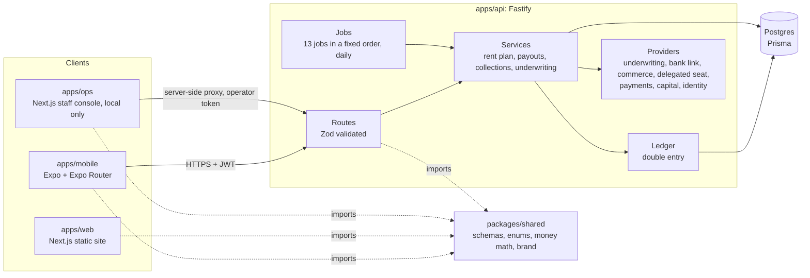
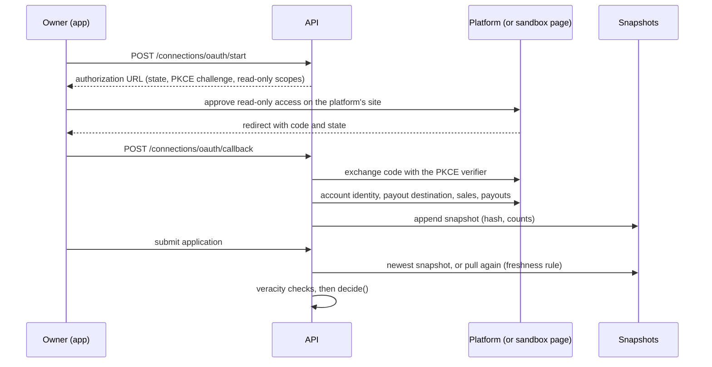
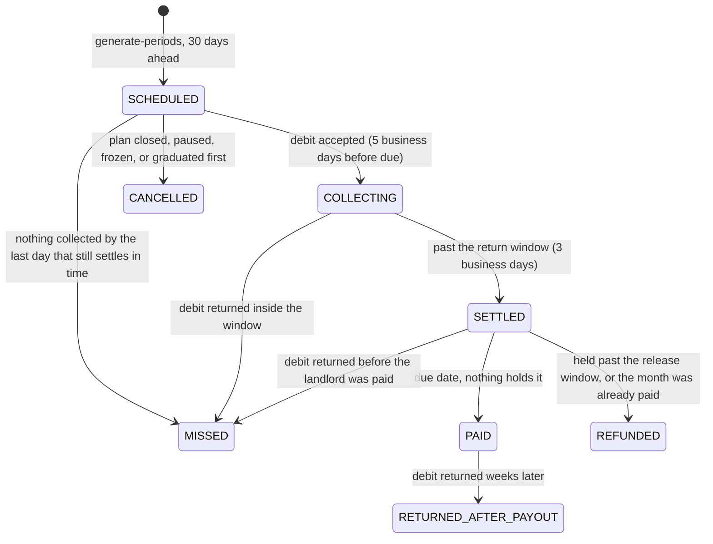
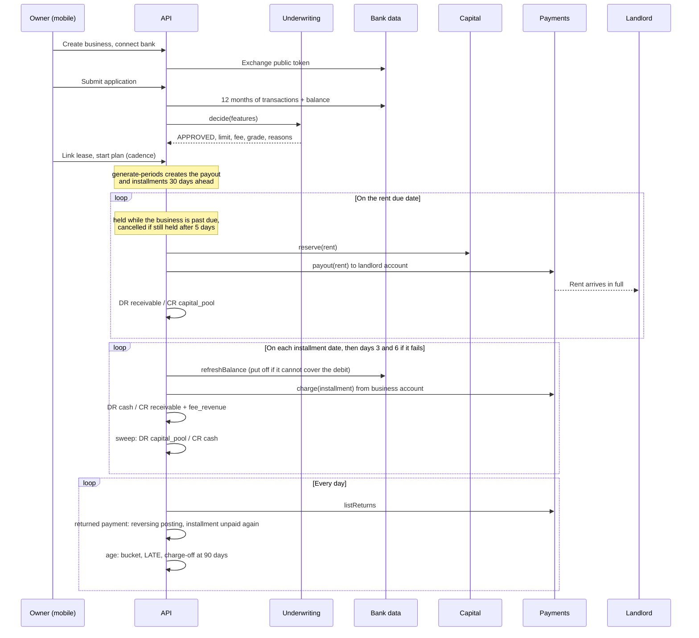
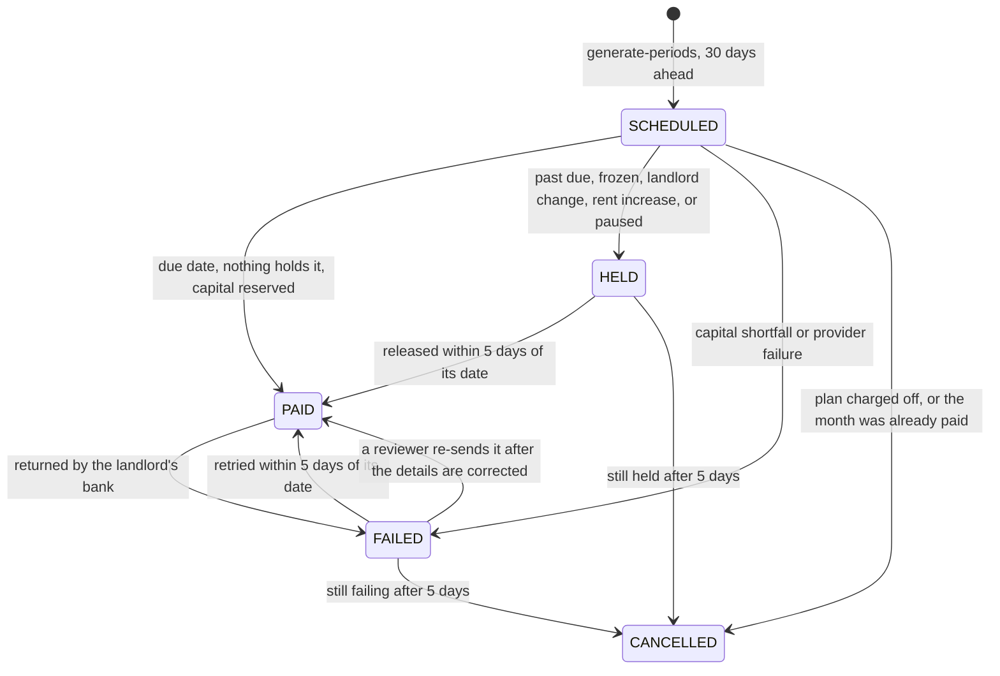
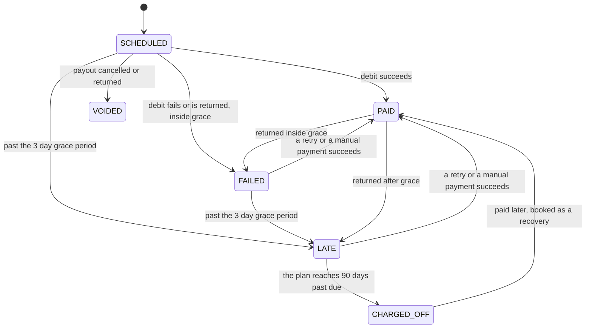

# Architecture

CashFlow is a pnpm and Turborepo monorepo with four apps and one shared package. This
document covers how the pieces fit, the provider seams where real money would plug in, the
data model, the ledger and its postings, the life of a rent payment, the jobs, monitoring,
dev tools, and security. The underwriting mechanics are in
[`apps/api/UNDERWRITING.md`](apps/api/UNDERWRITING.md), the credit policy in
[`apps/api/CREDIT_POLICY.md`](apps/api/CREDIT_POLICY.md), and the open legal questions in
[`COMPLIANCE.md`](COMPLIANCE.md).

Nothing in this repository moves real money. Every provider that could is a sandbox by
default, and the real adapters are skeletons that refuse to run without explicit
configuration.

## Packages

| Path              | What it is                                                                                                                                                                                        |
| ----------------- | ------------------------------------------------------------------------------------------------------------------------------------------------------------------------------------------------- |
| `packages/shared` | Zod schemas for every request and response, enums, brand tokens, and the pure installment math. Exported as TypeScript source; each consumer compiles it. No runtime dependency other than `zod`. |
| `apps/api`        | Fastify 5 with `fastify-type-provider-zod`, Prisma 7 on Postgres, pino logging, OpenAPI at `/docs`. Owns all business rules.                                                                      |
| `apps/mobile`     | Expo app for business owners. Thin client: validates server responses with the shared schemas and renders them.                                                                                   |
| `apps/web`        | One page marketing site, statically exported and hosted on Vercel.                                                                                                                                |
| `apps/ops`        | Operations console for staff, a Next.js app run locally and never deployed. Reads and acts only through the API's operator routes, by way of its own server-side proxy.                           |

Shared contracts are the spine. A schema is added to `packages/shared` first, the API
validates with it on both input and output, and the mobile app parses responses with the
same schema. A field that is not in the schema does not exist.

## Conventions that keep money honest

- **Integer cents everywhere.** No floats touch an amount. Rates are basis points.
- **Calendar dates are strings.** Due dates and periods are `YYYY-MM-DD` and compare
  lexicographically. There is no timezone bug to have because there is no Date object.
- **Every money movement posts a balanced ledger transaction** in the same database
  transaction as the status change it records. The service refuses unbalanced entries.
- **Jobs are idempotent.** Running a job twice for the same day is a no-op the second time,
  enforced by status checks and ledger idempotency keys.

## Terms

The docs use one word for each of these:

| Term              | Meaning                                                                                                          |
| ----------------- | ---------------------------------------------------------------------------------------------------------------- |
| Financed plan     | A `RentPlan` of kind `FINANCED`: CashFlow pays the landlord from the pool and the business repays with a fee     |
| Pass-through plan | A `RentPlan` of kind `PASS_THROUGH`: free, CashFlow collects the rent first and then pays the landlord           |
| Landlord payout   | One month's rent paid to the landlord (`LandlordPayout` on a financed plan, the payout of a `PassThroughPeriod`) |
| Installment       | One scheduled repayment of a financed plan's principal and fee (`Installment`)                                   |
| Refer, referral   | The engine sends an application to a reviewer instead of deciding (`REFER`, status `IN_REVIEW`)                  |
| Charge-off        | Writing off a plan's unpaid principal at 90 days past due; the balance is then "charged off"                     |
| Counter offer     | An approval for less than the rent requested. It cannot open a plan                                              |
| Freeze            | `advanceFrozenAt` on a plan: no new period and no landlord payout until a reviewer lifts it                      |

## Provider seams

Every external dependency that touches money or risk sits behind an interface in
`apps/api/src/providers/<name>/`. The implementation is chosen by an environment variable
and the sandbox implementation is always the default. Nothing in this repository can move
real funds without someone deliberately configuring it to.

| Provider                | Interface                                                                                                                                           | Default                                                                               | Real world                                                                                                     |
| ----------------------- | --------------------------------------------------------------------------------------------------------------------------------------------------- | ------------------------------------------------------------------------------------- | -------------------------------------------------------------------------------------------------------------- |
| `UnderwritingProvider`  | `decide(input) -> decision`                                                                                                                         | `cashflow`: the in-house cash flow engine, deterministic and explainable              | The same engine on real bank data, optionally blended with a bureau or vendor score                            |
| `BankLinkProvider`      | link token, exchange public token, balances, transactions, account identity, every account on the login, item health, revoke                        | `mock`: deterministic synthetic histories by token keyword, anchored on the link date | Plaid, MX, Finicity, bank-authorized OAuth. A `plaid.ts` skeleton shows the shape. No credentialed login, ever |
| `CommerceDataProvider`  | read-only OAuth (authorization URL with state and PKCE, code exchange, refresh, revoke), account identity, payout destination, daily sales, payouts | `mock` for every platform, with a sandbox consent page                                | Square, Shopify, Stripe, Clover skeletons, one per platform, chosen by `COMMERCE_PROVIDER`                     |
| `DelegatedSeatProvider` | invitation for CashFlow's own read-only service user, seat check, a `ReportPuller` that fails closed                                                | `mock` on the sandbox platform's data                                                 | A Toast skeleton that refuses to run. No browser automation exists                                             |
| `PaymentsProvider`      | `charge`, `payout`, idempotent by key; `listReturns`                                                                                                | `mock`: succeeds unless the token says `fail` or `return_r01` and so on               | Stripe, Modern Treasury, Increase. A `stripe.ts` skeleton shows the shape                                      |
| `CapitalProvider`       | `availableCents`, `reserve`, `fund`                                                                                                                 | `mock`: a pool that lives in the ledger                                               | A credit facility, a warehouse line, or a fund                                                                 |
| `IdentityProvider`      | `verifyBusiness`, `verifyOwners`, `screenParty`                                                                                                     | `mock`: verifies and clears everything except names with a sandbox keyword            | A business and owner verification vendor and a sanctions screening vendor. No skeleton is included             |

The environment variable that picks each one, and the values it accepts (`src/config.ts`):

| Variable                  | Values                                          | Default    | Guard                                                                                 |
| ------------------------- | ----------------------------------------------- | ---------- | ------------------------------------------------------------------------------------- |
| `UNDERWRITING_PROVIDER`   | `cashflow`, `mock`                              | `cashflow` |                                                                                       |
| `BANK_LINK_PROVIDER`      | `mock`, `plaid`                                 | `mock`     | `plaid` needs `CONNECTION_TOKEN_KEY`; `PLAID_ENV=production` is refused in production |
| `COMMERCE_PROVIDER`       | `mock`, `square`, `shopify`, `stripe`, `clover` | `mock`     | A platform name needs `CONNECTION_TOKEN_KEY` and that platform's credentials          |
| `DELEGATED_SEAT_PROVIDER` | `mock`, `toast`                                 | `mock`     | `toast` needs `CONNECTION_TOKEN_KEY`, and the skeleton refuses to run regardless      |
| `PAYMENTS_PROVIDER`       | `mock`, `stripe`                                | `mock`     | A live Stripe key (`sk_live_`) is refused in production                               |
| `CAPITAL_PROVIDER`        | `mock`                                          | `mock`     | No real adapter exists                                                                |
| `IDENTITY_PROVIDER`       | `mock`                                          | `mock`     | No real adapter exists                                                                |

### Data connections and snapshots

Every bank and point of sale connection records how its data is obtained (`DIRECT_OAUTH`,
`DELEGATED_SEAT`, or `AGGREGATOR`), what the platform or bank reports about the account (holder,
legal name, account type, created or opened, payout destination, every account on the login),
its scopes, token expiry, health, last pull, and revocation. Tokens are sealed with AES-256-GCM
(`src/crypto/token-vault.ts`) and never returned or logged. Every pull is stored as an
append-only `DataSnapshot` with a sha256 over its canonical payload, and underwriting reads
only through snapshots, re-pulling first when the newest is older than the policy allows.
Each decision stores the ids and hashes of the snapshots it read. There is no upload path and
no credentialed bank login. The design, the delegated seat's limits, token handling, and the
list for counsel are in [`apps/api/DATA_CONNECTIONS.md`](apps/api/DATA_CONNECTIONS.md) (the
questions are collected in [`COMPLIANCE.md`](COMPLIANCE.md)); the
veracity checks that run on the snapshots are in
[`apps/api/UNDERWRITING.md`](apps/api/UNDERWRITING.md), "Veracity".

## Data model

`apps/api/prisma/schema.prisma`, Postgres through Prisma. The tables by area:

| Area                  | Tables                                                                                        | Notes                                                                                        |
| --------------------- | --------------------------------------------------------------------------------------------- | -------------------------------------------------------------------------------------------- |
| People and businesses | `User`, `RefreshToken`, `Business`, `BeneficialOwner`, `ScreeningResult`                      | Tax id last four only; owners have no date of birth or government id. Screening is a history |
| Data connections      | `BankLink`, `CommerceLink`, `ConnectionAuthorization`, `DataSnapshot`                         | Tokens sealed. Every pull is a snapshot with a sha256                                        |
| Underwriting          | `UnderwritingApplication`, `UnderwritingDecision`, `ApplicationReview`, `AdverseActionNotice` | Decisions are superseded, never rewritten. One current decision per application              |
| Leases and plans      | `Lease`, `LeaseChange`, `RentPlan`, `PassThroughPeriod`, `GraduationOffer`                    | One pending landlord change per lease. A plan's `kind` is fixed for its life                 |
| Money movements       | `LandlordDisbursement`, `LandlordPayout`, `Installment`, `Repayment`                          | One `SENT` disbursement per lease and month                                                  |
| Ledger                | `LedgerAccount`, `LedgerTransaction`, `LedgerEntry`                                           | Balances are derived from entries, never stored                                              |
| Operations            | `AuditEvent`, `Alert`, `CircuitBreaker`, `JobRun`                                             | The latest `JobRun.asOf` is the simulated clock in dev                                       |

**Append only, enforced by a trigger** that rejects UPDATE and DELETE: `LedgerEntry`,
`LedgerTransaction`, `AuditEvent`, `DataSnapshot`, and `AdverseActionNotice`. The last three keep
plain id columns instead of foreign keys, so deleting a business never has to delete its
evidence. The `books.append_only_triggers_missing` monitoring rule checks that the triggers
exist.

**Append only by convention**: `UnderwritingDecision` (a new decision sets `supersededAt` on the
one before, and a partial unique index allows one current decision per application),
`ApplicationReview`, and `ScreeningResult` (superseded the same way).

**Unique indexes**, several of them partial, carry the invariants that would otherwise need a
lock: one ledger transaction per idempotency key, one current decision per application, one
periodic or eligibility review per application and month, one notice per decision and kind,
one payout and one pass-through month per plan and month, one pending `LeaseChange` per lease,
one open `GraduationOffer` per pass-through plan, one alert per dedupe key that is not
resolved, and one `SENT` landlord disbursement per lease and month.

## How a real capital source plugs in

The capital pool is the part that makes this a business rather than a demo. In the sandbox
it is a ledger account, `capital_pool`, seeded with $250,000 of `pool_equity`. Payouts draw
it down and collections sweep cash back into it.

A production `CapitalProvider` would implement the same three methods against a facility:

1. `availableCents()` reads undrawn capacity from the facility, net of concentration limits
   and any reserve requirement.
2. `reserve(amountCents, reference)` draws against the facility for a specific payout and
   returns a reference, or throws `InsufficientCapitalError`, in which case the payout is
   marked `FAILED` with the reason and tried again on the next run, for as long as it is
   inside its release window (see "Holds" below). Nothing else in the system changes.
3. `fund(amountCents)` records a capital contribution or facility draw as `pool_equity` so
   the ledger still balances.

The ledger does not care where the money came from. A facility provider posts the same
entries as the mock; the difference is that `reserve` has a real counterparty. Collections
sweep cash into `capital_pool` on the same schedule, and the fee stays in `fee_revenue`,
which is what pays the facility's interest and the company's costs.

## Ledger

Five account types. Nine system accounts plus one receivable per business:

| Code                      | Type           | Meaning                                                     |
| ------------------------- | -------------- | ----------------------------------------------------------- |
| `capital_pool`            | Asset          | Cash available to front rent                                |
| `cash`                    | Asset          | Installments collected, not yet swept                       |
| `receivable:<businessId>` | Asset          | Rent fronted for a business, not yet repaid or charged off  |
| `allowance:credit_losses` | Asset (contra) | The part of receivables not expected back. A credit balance |
| `fee_revenue`             | Revenue        | Fees collected                                              |
| `recovery_income`         | Revenue        | Principal collected on balances already charged off         |
| `provision_expense`       | Expense        | Cost of building the allowance                              |
| `pool_equity`             | Equity         | Capital contributed to the pool                             |
| `landlord_payable`        | Liability      | Pass-through rent collected and not yet paid to a landlord  |
| `pass_through_cash`       | Asset          | The cash behind `landlord_payable`, never swept to the pool |

Net receivables are the receivable accounts less the allowance. The allowance is typed as an
asset with a credit balance, so its natural balance reads negative and adding it to the
receivables gives the net figure.

| Event                                      | Debit                     | Credit                                              |
| ------------------------------------------ | ------------------------- | --------------------------------------------------- |
| Pool funded                                | `capital_pool`            | `pool_equity`                                       |
| Landlord paid                              | `receivable:<biz>`        | `capital_pool`                                      |
| Installment collected                      | `cash` (total)            | `receivable:<biz>` (principal), `fee_revenue` (fee) |
| Cash swept                                 | `capital_pool`            | `cash`                                              |
| Collected installment returned by the bank | mirror of the collection  | mirror of the collection                            |
| Returned payments covered from the pool    | `cash`                    | `capital_pool`                                      |
| Landlord payout returned by the bank       | `capital_pool`            | `receivable:<biz>`                                  |
| Monthly provision, allowance built         | `provision_expense`       | `allowance:credit_losses`                           |
| Monthly provision, allowance released      | `allowance:credit_losses` | `provision_expense`                                 |
| Charge-off                                 | `allowance:credit_losses` | `receivable:<biz>` (unpaid principal)               |
| Payment on a charged off installment       | `cash` (total)            | `recovery_income` (principal), `fee_revenue` (fee)  |
| Pass-through rent collected                | `pass_through_cash`       | `landlord_payable`                                  |
| Pass-through rent paid to the landlord     | `landlord_payable`        | `pass_through_cash`                                 |
| Pass-through collection returned, unpaid   | mirror of the collection  | mirror of the collection                            |
| Pass-through rent refunded to the business | `landlord_payable`        | `pass_through_cash`                                 |
| Pass-through collection returned after pay | `receivable:<biz>`        | `capital_pool` (via `pass_through_cash`)            |

Rules the postings follow:

- **Append only.** Database triggers reject UPDATE and DELETE on ledger rows. A return is
  undone by posting the mirror image of the original transaction (`reverseTransaction`), never
  by editing it.
- **A fee is revenue only when it is collected.** An unpaid fee is never booked, so a
  charge-off charges off principal only and books no fee revenue and no fee loss.
- **A charge-off never takes the allowance below zero.** If the allowance is short of the
  principal being charged off, the same database transaction first tops it up with
  DR `provision_expense` / CR `allowance:credit_losses`.
- **Two dates.** `postedAt` is when the row was written. `effectiveDate` is the calendar
  date the movement belongs to: the job's as-of date, or the date a return arrived. They
  differ when history is replayed with `job:run --as-of`, as the seed does.
- **One posting per business event**, enforced by idempotency keys: `payout:<id>`,
  `repayment:<id>` (an installment whose payment was returned is collected again, which is a
  second repayment and a second posting), `repayment:<id>:return`, `payout:<id>:return`,
  `provision:<YYYY-MM>`, `charge_off:<planId>:<date>` (and `:provision` for its allowance top
  up), and `payout:<id>:resend:<n>` with its own `:return` for a returned payout that a
  reviewer sent again. Pass-through months post under `pass_through:<periodId>:collect:<n>`
  (with `:return`, or `:return_after_payout` once the landlord was paid), `:payout`, and
  `:refund`.
- **One landlord payout per lease and month.** Every payment of rent to a landlord, from
  either kind of plan, first claims a `LandlordDisbursement` row in the same transaction,
  before the provider is called. A partial unique index allows one `SENT` row per lease and
  period month, and the payout row is locked (`SELECT ... FOR UPDATE`) for the transaction.
  So a held payout that is released twice, two payout runs at once, or two plans on one lease
  (a paused plan and a new one, a pass-through plan and its financed successor) can never
  pay the same month twice. A payment the landlord's bank returned is marked `RETURNED` and
  stops counting, so a reviewer's re-send works. A refused second payment cancels the payout
  with `PERIOD_ALREADY_PAID` and opens a high severity alert.

Balances are derived by summing entries, never stored. `GET /v1/admin/ledger/trial-balance`
proves debits equal credits at any moment, the integration tests assert it after every
lifecycle step, and the `monitor` job checks it, and each receivable account against the
installments behind it, on every run. `GET /v1/admin/delinquency` reports receivables, the allowance, charge-offs
and recoveries to date, and plans and principal by delinquency bucket.

## Plan kinds

A `RentPlan` has a `kind`, fixed for its life:

| Kind           | Who                                                | What CashFlow does                                                                           | Fee  |
| -------------- | -------------------------------------------------- | -------------------------------------------------------------------------------------------- | ---- |
| `FINANCED`     | Approved                                           | Pays the landlord in full from the pool on the due date; the business repays in installments | Yes  |
| `PASS_THROUGH` | Declined for credit capacity (see UNDERWRITING.md) | Collects the rent from the business first, pays the landlord once the collection has settled | None |

A pass-through customer with enough on time months can graduate: a new financed plan opens on
the same lease from the next month and the pass-through plan closes (`GRADUATED`). Exposure,
the pool, provisioning, delinquency buckets and the monitoring portfolio rules read financed
plans only.

### Pass-through plans

`src/services/pass-through.ts`, with the rules as pure functions in
`src/servicing/pass-through.ts` (`STANDARD_PASS_THROUGH_POLICY`). One `PassThroughPeriod` per
month, through these statuses:

- **Collect.** From `collectOn` (five business days before the due date, counted back from
  the last business day on or before it) the whole rent is debited after a balance check,
  at most twice, until `lastCollectOn` (three business days before). A debit the balance
  cannot cover is put off a day without using an attempt. Posted DR `pass_through_cash` /
  CR `landlord_payable`. The daily cash sweep never touches it.
- **Settle.** Three business days is longer than the window in which an insufficient funds
  return comes back (two banking days; `MOCK_RETURN_DAYS` in the sandbox), so a bounced debit
  makes the month `MISSED` with the reversing posting before the landlord would be paid.
- **Pay.** On the due date, `process-payouts` pays a settled month: a disbursement claim, the
  provider call, DR `landlord_payable` / CR `pass_through_cash`. Only from settled money,
  never before the due date. A landlord change in its cooling-off period, a frozen plan or an
  open screening hit holds it; past five days the money goes back to the business (`REFUNDED`).
- **Missed.** CashFlow does not pay the landlord. The owner is told plainly, on the plan and in
  the app, to pay the landlord directly. No fee, no late fee. The month is `MISSED` in the
  payment history and withdraws an open graduation offer.
- **Returned after payout.** An unauthorized return can arrive weeks after the landlord was
  paid. The rent has gone out and cannot be taken back, so CashFlow's own money covers the
  hole: one posting takes the collection out of `pass_through_cash`, puts the pool's money
  back in, and books the amount on the business's receivable (DR `receivable:<biz>` /
  CR `capital_pool`, net). The plan is closed and a high severity alert opens. This is the
  one way a pass-through plan can cost CashFlow money.
- **Returned landlord payout.** Sent back by the landlord's bank: reversed, refunded to the
  business, and the plan frozen until the landlord details are corrected.

Two monitoring rules watch it: `books.pass_through_payout_before_settlement` (critical, a
landlord paid on a pass-through plan without a settled collection behind it, which should be
impossible) and `books.landlord_payable_mismatch` (critical, `landlord_payable` and
`pass_through_cash` must both equal the months collected and not yet paid or sent back).

## The life of a rent payment

### Payout and installment states

A financed plan's landlord payout (`LandlordPayout.status`):

Its installments (`Installment.status`). Collection starts only once the payout is `PAID`:

The plan itself is `ACTIVE`, `PAUSED` (by the owner: no new periods, collections continue) or
`CLOSED` (by the owner, at charge-off, or on graduation for a pass-through plan). A freeze is
not a status: it is `advanceFrozenAt` on an active plan.

### Servicing policy

Everything that happens after a landlord payout follows one object,
`ACTIVE_SERVICING_POLICY` in `apps/api/src/servicing/policy.ts`: pure functions with no
database or clock. The services ask it when to debit, when to hold a payout, which bucket a
plan is in, how much to reserve, and when to charge off. The portfolio simulator in
`apps/api/src/evals/` calls the same functions, so the policy that is evaluated is the policy
that runs.

| Rule                | Standard policy                                                                                                     |
| ------------------- | ------------------------------------------------------------------------------------------------------------------- |
| Grace               | 3 days. An installment is `LATE` from day 4                                                                         |
| Delinquency buckets | `CURRENT` (nothing past due), `GRACE` (1 to 3 days), `DELINQUENT` (4 to 29), `DEFAULT` (30 and over), `CHARGED_OFF` |
| Collection attempts | At most 3 per installment per bank account, on days 0, 3, and 6                                                     |
| Balance check       | Before each scheduled debit. A debit the balance cannot cover is put off a day and is not an attempt                |
| Stop-advance        | The next landlord payout is held while anything is more than 3 days past due                                        |
| Release window      | A payout not paid within 5 days of its scheduled date is cancelled, never paid late                                 |
| Charge-off          | At 90 days past due. The whole unpaid balance is charged off and the plan is closed                                 |
| Reserve rates       | 0.40% of current principal, 85% of grace, 95% of delinquent, 100% of default. Measured in the evals                 |
| Return codes        | Retryable (R01, R09), hard (R02, R03, R04, R08, R13, R16, R20), unauthorized (R05, R07, R10, R29)                   |

Days past due is the age of a plan's oldest unpaid installment. It is derived from the
installments on every read and never stored, because it changes at midnight without any
event. The bucket is stored on the plan (`RentPlan.delinquencyStatus`), because a change of
bucket is an event: it is audited, provisioning reserves by it, and the ops summary groups by
it.

### Holds

A payout that falls due is paid, held, or cancelled by `processPayout`:

- It is **held** (`HELD`, with a reason the owner sees through `GET /v1/rent-plans/:id`)
  while the business is more than 3 days past due on rent already fronted, on any of its
  plans (`PAST_DUE`); while the plan is frozen by a periodic review, an unauthorized return,
  a returned payout, or a screening hit (`ADVANCE_FROZEN`); while a change to the landlord's
  details is inside its cooling-off period (`LEASE_CHANGE_PENDING`); while a rent increase
  waits for a new decision (`RENT_INCREASE_PENDING`); or while the owner has paused the plan
  (`PLAN_PAUSED`). The payout carries a `heldMessage` in plain words for the owner.
- A held payout is **released** and paid as soon as nothing holds it, if that is within 5
  days of its scheduled date. Its installments move out by the number of days it was late.
- After 5 days it is **cancelled** and its installments are voided. A month the tenant has
  had to settle with the landlord directly is never paid late, and a month that went by while
  a plan was paused or frozen is never generated afterwards.
- A payout that fails for lack of capital or at the provider is `FAILED` and retried on each
  run inside the same 5 days, then cancelled.

Pausing a plan stops new rent periods. It does not stop collection: installments on rent
already paid to the landlord are debited on schedule whether the plan is active, paused, or
closed. A freeze is lifted only by a reviewer, with
`POST /v1/admin/rent-plans/:id/release-freeze`, or, for a screening freeze, by clearing the
hit.

### Collections and returns

`collectInstallment` asks the policy whether a debit is scheduled today. Before debiting it
reads the balance through the bank link provider; a debit that would obviously fail is put
off to the next run, the reason is recorded on the installment, and no attempt is used. Each
debit that is presented counts, whether it fails on the spot or comes back later. After the
third the installment is debited no more and waits for a manual payment
(`POST /v1/repayments`), which works for a late, defaulted, or charged off balance.

A bank debit is booked when it is made and can come back afterwards. There are no webhooks:
`reconcile-payments` polls `PaymentsProvider.listReturns` and, in one database transaction
per return, marks the repayment `RETURNED`, makes the installment unpaid again, and posts the
reversing ledger transaction. What happens next depends on the class of the code:

| Class        | Codes                             | Effect beyond the reversal                                                                                   |
| ------------ | --------------------------------- | ------------------------------------------------------------------------------------------------------------ |
| Retryable    | R01, R09                          | None. The return counted as an attempt and the retry schedule continues                                      |
| Hard         | R02, R03, R04, R08, R13, R16, R20 | The bank link is disabled. No automatic debit until the business links an account again                      |
| Unauthorized | R05, R07, R10, R29                | The same, and the plan is frozen from further advances, and a high severity `UNAUTHORIZED_RETURN` is written |

A returned payment never counts as on time: a period with any returned payment does not move
a business up the limit ladder, even if it was collected again inside grace.

A landlord payout can come back too, from a closed or wrong account. The pool gets the rent
back and the receivable is taken off with a reversing posting, the payout is `FAILED` with
the code, installments not yet collected are voided, and the plan is frozen. Principal
already collected for that month is left as a credit on the business's receivable account
and reported in the `PAYOUT_RETURNED` audit event so that it can be refunded.

The mock payments provider produces all of this from token keywords: `fail` rejects on the
spot, `return_r01` accepts and returns two days later with that code, `late_return_r10`
returns three weeks later, and `_once` limits it to the first payment on the token.

### Charge-off and recovery

When a plan's oldest unpaid installment reaches 90 days past due, `age-receivables` writes
off everything the plan still owes: DR `allowance:credit_losses` / CR the receivable for the
unpaid principal, the installments become `CHARGED_OFF`, payouts not yet made are cancelled,
the plan is `CLOSED` with bucket `CHARGED_OFF`, the business is `SUSPENDED`, and its other
plans are frozen. A charged off installment is still owed. If it is paid later, by a manual
payment, the principal is booked to `recovery_income` and the plan stays closed.

### Jobs

Thirteen jobs in `apps/api/src/jobs/` run in this order, on a cron inside the API process
(`JOBS_ENABLED=true`) or by hand with `pnpm --filter @cashflow/api job:run --as-of
YYYY-MM-DD`. Each is idempotent for a given date:

1. **rescreen** screens every active business, its owners, and its landlords against
   sanctions and watchlists once their last screening is 30 days old. A hit freezes the plan
   before anything is generated or paid for it that day.
2. **lease-changes** applies landlord and payout changes whose cooling-off period has ended,
   so a payout they were holding goes out the same day to the new details.
3. **refresh-connections** refreshes platform tokens within three days of expiry, pulls
   every business with an active plan again once its last pull is seven days old (through the
   same path a decision uses), runs the veracity checks on the result, and audits the
   assessment, which the monitoring rules read. A failed pull marks the connection. Once a
   day per business.
4. **reunderwrite** re-scores each active financed plan once a month and freezes one that
   has deteriorated. Before payouts, so a plan it freezes gets no new period and no payout the
   same day.
5. **refresh-eligibility** expires stale graduation offers, opens the financed plan for an
   accepted one once no pass-through month is in flight, and re-underwrites pass-through
   customers with three on time months in a row on fresh data and payment history, at most
   once a month, offering a financed plan when they now qualify. See UNDERWRITING.md,
   "Graduation".
6. **reconcile-payments** polls for returned payments and undoes each one, pass-through
   collections included. Before anything reads who is paid up.
7. **age-receivables** recomputes every plan's delinquency bucket, marks installments
   `LATE` once past grace whether or not a debit was attempted, writes an audit event on
   every change of bucket, and charges off plans at 90 days.
8. **generate-periods** creates next month's landlord payout and its installments for every
   active financed plan that is not frozen, 30 days before the due date, using
   `buildInstallmentSchedule` from `packages/shared`, and next month's pass-through month for
   every active pass-through plan.
9. **process-payouts** pays, holds, releases, or cancels every payout that is due: reserve
   capital, claim the month, call the payments provider, post the ledger, mark `PAID`. A
   capital shortfall or a provider failure marks the payout `FAILED` with the reason and it is
   tried again on the next run. Then pass-through collections past their return window
   settle, and settled months that are due are paid to the landlord.
10. **collect-installments** makes the debits the policy schedules for today on every
    installment whose payout has been paid, posts the ledger, and settles operating cash with
    the pool. Then the pass-through debits whose window is open.
11. **provision** sets the allowance to the policy's reserve on outstanding principal by
    bucket and posts the change. It posts on the first run of each calendar month only.
12. **adverse-action-notices** stores the notices that fall due on a date rather than with a
    decision: a counter offer not taken up in 30 days, a notice of incompleteness for an
    application waiting 10 days on information, the notice that closes it 30 days later, and
    any decline that has no notice. See "Adverse action notices".
13. **monitor** runs every monitoring rule on the state the others left and opens, refreshes,
    and resolves alerts. See "Monitoring".

Each run records a `JobRun` row with a summary so a dashboard or an on-call engineer can see
what happened on any given day.

## Identity and screening

`IdentityProvider` (`IDENTITY_PROVIDER`, default `mock`) answers three questions: is this
business a registered entity matching the legal name, address, tax id and formation date it
gave; are its beneficial owners identifiable people; and does a name appear on a sanctions
list or a watchlist. `services/identity.ts` decides when to ask and what to do with the
answer.

What is stored is deliberately little. A business keeps the **last four digits** of its tax
id, never the full number. An owner is a name, a title, an ownership share in basis points,
and an opaque reference to the provider's record. No date of birth and no government id
number is collected or stored anywhere. A business needs at least one owner, and the shares
may not add up to more than 100%.

| When                                                | What runs                                                              |
| --------------------------------------------------- | ---------------------------------------------------------------------- |
| A business is created, or an identity field changes | Verify the business and its owners, screen the business and each owner |
| An application is submitted                         | The same again, then the stored result goes to the engine              |
| A lease is created, or its landlord changes         | Screen the landlord (name and payout account holder) as the payee      |
| Every 30 days (`rescreen` job)                      | Screen every active business, its owners, and its landlords again      |

Verification is `VERIFIED`, `REVIEW`, or `FAILED` (`UNVERIFIED` before the first check). The
business carries the worst status across itself and its owners. Screening is a history in
`ScreeningResult`: each screening adds a row and supersedes the party's previous one, and a
hit (`POSSIBLE_MATCH` or `MATCH`) is open until a reviewer clears it, with who and why. A hit
whose provider reference was already cleared for the business is stored as cleared, so a
false positive does not come back every month.

What the results do:

- **Applications.** The engine gets the stored status and the worst open hit as an integrity
  input, the same way it gets the other facts the service looks up, and stays pure. Anything
  short of `VERIFIED` with clear screening is never approved automatically: `REVIEW` or a
  possible match is referred with a specific trigger, `FAILED` is declined with a reason the
  applicant can act on, and a match is held in review and cannot be approved while it is open.
- **Running plans.** A hit on the business, an owner, or the landlord of a plan freezes that
  plan with the existing freeze (`advanceFrozenAt`, reason `SCREENING_REVIEW`), so the payout
  job holds what falls due. Clearing the hit (`POST /v1/admin/screening/:id/clear`) releases
  every plan it froze that has no other open hit. A reviewer can clear a possible match; a
  match needs an admin. The general freeze release is refused while a hit is open.
- **New plans.** `createRentPlan` refuses while a hit is open on the business, an owner, or
  that lease's landlord.

The owner is never told what was found. `Business.verification` has three states: `VERIFIED`,
`NEEDS_INFO` (a tax id or an owner is missing), and `UNDER_REVIEW`, which covers a check in
review, a failed check, and any screening hit alike, with a message to contact support. A
payout held by a freeze says the account is under review.

A business that existed before verification has no tax id and no owners. It migrates as
`UNVERIFIED`, reads as `NEEDS_INFO` to its owner, and its next application is referred rather
than approved.

## Lease change control

Landlord payouts read the lease when they run, so whoever can edit a lease can choose where
next month's rent goes. An account takeover would use exactly that. `PATCH /v1/leases/:id`
therefore treats three kinds of field differently (`services/lease-changes.ts`):

**Landlord identity and payout account** (`landlordName`, `landlordEmail`, `landlordPayout`).
On a lease with a plan that is not closed, the change does not apply. It becomes a
`LeaseChange` with a cooling-off period of 5 days (`CONTROLS_POLICY`):

- payouts on the lease are held with reason `LEASE_CHANGE_PENDING` until it is settled;
- the proposed landlord is screened;
- a `LEASE_CHANGE_REQUESTED` audit event is written and an alert opens at once;
- the owner sees `Lease.pendingChange` with the date, and can cancel it
  (`POST /v1/leases/:id/pending-change/cancel`);
- the `lease-changes` job applies it when the period ends, a reviewer can approve it earlier
  or reject it (`POST /v1/admin/lease-changes/:id/decide`), and it does not apply while the
  proposed landlord has an open screening hit;
- one change can be pending per lease, and a payout account that is the business's own bank
  account is refused outright.

Five days is also the payout release window, so a payout that falls due on the day of an
honest change is held and then paid to the new account on the day the change applies. It is
never cancelled by the wait. On a lease with no running plan there is no payout to redirect,
and the change applies at once, with the landlord screened and the edit audited.

**Rent.** A decrease, or an increase that the current approval and the exposure rules still
cover (`checkNewPlan`, with the plan's own rent left out of the business's exposure), moves
the plan to the new rent, reprices the fee, and regenerates every period that has not been
paid to the landlord. A period already paid keeps its amount. An increase they do not cover
is recorded on the plan (`pendingRentCents`) and its payouts are held with reason
`RENT_INCREASE_PENDING`: CashFlow fronts a whole month's rent or nothing, so it does not pay
the old amount against a higher rent. The owner sees `Lease.pendingRentIncrease`. A new
application for the business that is approved for at least the new rent applies it (the plan
moves to that application and its fee); putting the rent back clears it. A held payout is
cancelled after its release window like any other.

**Everything else** (property address, dates, due day) applies at once, as before.

**Re-sending a returned payout.** A landlord payout that came back from the bank is `FAILED`
with the return code and is never retried by the job. Once the landlord's details have been
corrected through a lease change that applied after the return, a reviewer can send it again
(`POST /v1/admin/payouts/:id/resend`). It posts a second ledger transaction under its own key
(`payout:<id>:resend:<n>`), makes the installments the return voided owed again from today,
and leaves the plan frozen for a reviewer to release separately.

## Adverse action notices

Every decline, counter offer not taken up, and application left incomplete produces a notice
the applicant reads in the app. `AdverseActionNotice` stores each one exactly as delivered:
kind, principal reasons, full text, statement version, the action date, the deadline it had
to meet, delivery time and channel. It is append only (a row trigger, as on `AuditEvent`)
and has no foreign keys (as `DataSnapshot`), so deleting a business never deletes the
record of what it was told. One notice per decision and kind, under a unique index.

- A decline's notice is written in the transaction that writes the decision, by the engine
  (`services/underwriting.ts`) or a reviewer (`services/reviews.ts`).
- The rest are written by the `adverse-action-notices` job, from the pure schedule in
  `src/adverse-action/schedule.ts`, which monitoring also reads; or by the owner declining a
  counter offer.
- `UnderwritingDecision.principalReasons` holds the at most four catalog reasons the
  applicant is told, chosen by `selectPrincipalReasons` in `packages/shared`.

The reasoning and the regulation sections are in
[`apps/api/UNDERWRITING.md`](apps/api/UNDERWRITING.md), "Reasons and adverse action notices";
what is and is not settled about them is in [`COMPLIANCE.md`](COMPLIANCE.md).

## Monitoring

`apps/api/src/monitoring/` turns the state of the system into alerts for a person.

- **Rules** (`rules/*.ts`) are pure functions from `MonitoringInputs` to the alerts that
  should be open right now. They never touch the database.
- **The data layer** (`data.ts`) is the only place monitoring reads the database, and it
  makes no judgments.
- **The policy** (`policy.ts`) holds every threshold in one object, each with its reasoning.
  Caps come from the credit policy, so monitoring and underwriting cannot drift apart.
- **The engine** (`engine.ts`) runs the rules and decides, purely, what to write given the
  alerts that exist. **The service** (`service.ts`) writes it.

The `monitor` job runs last in every job run. An `Alert` has a type (the rule), a category, a
severity (`INFO`, `WARNING`, `HIGH`, `CRITICAL`), a subject, a status (`OPEN`,
`ACKNOWLEDGED`, `RESOLVED`), a disposition, and a dedupe key. How alerts open and close:

- **One alert per condition.** A partial unique index allows one alert per dedupe key that is
  not resolved. A condition that persists refreshes its alert (and raises its severity if the
  condition got worse) instead of opening another.
- **Auto-resolve.** Rules whose alert is fully described by current state resolve it when the
  condition is gone, with disposition `CONDITION_CLEARED`. Rules about something that cannot
  undo itself do not: the trial balance, a landlord account that is a borrower's, a deleted
  record, and every alert raised from an event.
- **Events open once.** Servicing already detects unauthorized returns, returned payouts,
  charge-offs, disabled bank links and cancelled payouts, and writes an audit event in the
  same transaction. Monitoring does not detect them again. It turns each event that needs a
  person into one alert keyed by the event, never reopened after it is resolved.
- **A person's resolution sticks.** An alert a person resolved does not reopen for the same
  condition for 30 days. One the monitor resolved can reopen straight away.
- **A broken rule is isolated.** A rule that throws is logged and reported in the job run,
  the others still run, and its open alerts are left alone.

| Category                                   | Rules                                                                                                                                                                                                                                                                                                                                                                                                                                                                                                                                                                               |
| ------------------------------------------ | ----------------------------------------------------------------------------------------------------------------------------------------------------------------------------------------------------------------------------------------------------------------------------------------------------------------------------------------------------------------------------------------------------------------------------------------------------------------------------------------------------------------------------------------------------------------------------------- |
| Fraud                                      | Landlord change pending, or applied shortly before a payout. Landlord payout account is a borrower's bank account. One landlord account paid by several unrelated users. One bank account linked by several businesses. Application velocity and reapplying after a decline. Open screening hits. Unauthorized returns and account lockouts (from events)                                                                                                                                                                                                                           |
| Payments                                   | Unauthorized, administrative and overall return rates over 60 days against the network thresholds, each with a minimum sample. Repeated failures on one bank account. Collection attempts exhausted. Returned and cancelled payouts, disabled bank links (from events)                                                                                                                                                                                                                                                                                                              |
| Portfolio                                  | First payment default rate by origination month. Share of principal delinquent or in default. Month over month roll. Industry and single name concentration against the credit policy caps. Pool utilization. Realized against expected loss by cohort. Charge-offs (from events)                                                                                                                                                                                                                                                                                                   |
| Books                                      | Trial balance. Operating cash left after a full run. Each receivable account against unpaid principal on paid payouts (and pass-through rent returned after payout). Allowance and pool never negative. Jobs that failed or stopped. Append-only triggers present (`pg_trigger`). Landlord paid on a pass-through plan without a settled collection. `landlord_payable` and `pass_through_cash` against collected, unpaid pass-through months. A second landlord payout for a month refused (from events)                                                                           |
| Data (alert categories FRAUD and PAYMENTS) | A bank or platform connection on a business with an active plan that needs reconnecting, fails, or has an expired token (warning, high for a bank; auto-resolves). History rewritten between pulls (high, critical when it flatters; once, closed by a person). A platform's payout destination changed after the plan started (warning; once). Settlement match fell 20 points from the decision to under 85% (warning, high under 50%; auto-resolves). Several businesses under different users on one platform account or payout account (warning, high at three; auto-resolves) |
| Compliance                                 | Applications undecided at 20 and 30 days. Screening results older than the rescreen interval. An application deleted inside the 12 month retention period. Businesses with a plan that are not verified. Adverse action notice missing (high, critical past its deadline), or delivered late                                                                                                                                                                                                                                                                                        |

Every rule's threshold, severity and reasoning is in `monitoring/policy.ts` and the rule's own
description, which the summary endpoint returns.

### The circuit breaker

Five portfolio rules trip a persisted circuit breaker at their critical level: first payment
defaults, delinquent share, roll, loss against expectation, and commitments above pool
capital. It is one mechanism: **while it is tripped, an application the engine would approve
is referred to a reviewer instead** (trigger `CIRCUIT_BREAKER`). Declines and requests for
information are unchanged, and a reviewer can still approve.

Referring was chosen over pausing new plans because those breaches say recent automatic
decisions may be wrong, and the remedy for that is a person on each new approval, which the
review queue already provides. It does not strand an owner halfway through onboarding with an
error, and it leaves good applicants a way through. Its limit: an approval made before the
trip stays valid, and that owner can still open a plan, subject to the exposure and pool
rules `createRentPlan` applies on the day.

The breaker trips when a breaker alert opens or rises to critical, not on every run while it
stays open, so an admin's reset (`POST /v1/admin/circuit-breaker/reset`, with a reason) is not
undone by the next run. Trip and reset are both audited.

One thing monitoring cannot see is itself. If the scheduler stops, the `monitor` job stops
with it and nothing alerts. A production deployment needs a heartbeat checked from outside.

## Security and access control

What protects what, in one place:

| Concern                         | Control                                                                                                                                           |
| ------------------------------- | ------------------------------------------------------------------------------------------------------------------------------------------------- |
| Owner sign in                   | scrypt password hashes, 15 minute access tokens, rotating refresh tokens (see "Auth")                                                             |
| Guessing passwords              | Per address rate limits and a per account lockout (below)                                                                                         |
| Operator routes                 | Off unless `ENABLE_ADMIN=true`; two role tokens and a named actor on every request (below)                                                        |
| Platform and aggregator tokens  | Sealed with AES-256-GCM under `CONNECTION_TOKEN_KEY` (`src/crypto/token-vault.ts`), never returned or logged                                      |
| Redirected rent                 | Landlord changes wait out a 5 day cooling-off period with payouts held (see "Lease change control")                                               |
| Paying a month twice            | One `SENT` landlord disbursement per lease and month, enforced by the database                                                                    |
| Tampering with records          | Append only triggers on the ledger, audit, snapshot and notice tables                                                                             |
| Real money                      | Every provider defaults to a sandbox; with `NODE_ENV=production` a live Stripe key or a production Plaid, Square or Clover environment is refused |
| Dev tools                       | Off by default, refused in production, not registered when off, local callers only (see "Dev mode")                                               |
| The operator token in a browser | Never reaches browser JavaScript (see "The operations console")                                                                                   |

### Operator access

The operator routes under `/v1/admin` exist only when `ENABLE_ADMIN=true`, and the API refuses
to start in that mode without `ADMIN_API_TOKEN`. Every request needs:

- `Authorization: Bearer <token>`: `ADMIN_API_TOKEN` or `REVIEWER_API_TOKEN`, at least 32
  characters each and different from one another, compared in constant time.
- `X-Admin-Actor: <name or email>`: the person acting.

| Role       | Can                                                                                                                                                                                               |
| ---------- | ------------------------------------------------------------------------------------------------------------------------------------------------------------------------------------------------- |
| `reviewer` | Work the review queue, alerts, lease changes, and screening hits. Release a freeze. Re-send a returned payout. Read the ledger, capital, delinquency, audit trail, breaker and monitoring summary |
| `admin`    | Everything a reviewer can, plus fund the pool, run jobs, reset the circuit breaker, and clear a screening match                                                                                   |

The identity written to the audit log is the token's role and the name in the header. No
request body can set it; the review and freeze endpoints that used to take a `reviewer` field
no longer do. Every state change through these routes writes an audit event.

This is deliberately small. A token proves a role and is shared by a team; the header is
asserted by the caller, not proven. That is enough to keep the routes closed and the audit
trail honest about role. Per person credentials are what a production deployment needs.

Rate limiting (`@fastify/rate-limit`) applies a default per client address to every route and
a tighter limit to register, login and refresh. Separately, five wrong passwords in a row
lock an account for 15 minutes and write a `LOGIN_LOCKED` audit event. Rate limiting counts
requests per address; lockout counts failures per account, which is what stops guessing that
comes from many addresses. Both are configurable, and rate limiting is off under test.

### The operations console

`apps/ops` is the staff interface over the operator routes: review queue, alerts, lease
changes, screening, portfolio, customers, audit log, and the policy in force. It has no
database and no business rules of its own. It is a Next.js app that runs on a staff machine.

The operator token never reaches browser JavaScript:

1. The sign-in page posts the token and the operator's name to the console's own server
   (`POST /api/session`). The server checks them against `GET /v1/admin/whoami`, which also
   says which role the token carries.
2. On success the server seals `{ token, actor, role, expiresAt }` with AES-256-GCM under a
   key derived from `OPS_SESSION_SECRET` and sets it as a cookie that is `HttpOnly`,
   `SameSite=Strict`, and `Secure` unless the host is localhost. The response body carries
   the name and role only. There is no server-side session store.
3. Every API call from a page goes to the console's `/api/admin/...`. The handler opens the
   cookie, attaches `Authorization` and `X-Admin-Actor`, and forwards the request, but only
   to the routes on its allowlist (`apps/ops/lib/server/routes.ts`). Funding the pool and
   running jobs are not on it. Browser cookies and headers are not forwarded upstream and
   upstream headers are not passed back.
4. A state-changing request must carry an `Origin` that names the console's own host (or
   `Sec-Fetch-Site: same-origin`), on top of the cookie being `SameSite=Strict`.

The role shown in the console only decides which actions it offers. The API enforces the
role on every request regardless. Responses are parsed in the browser with the same shared
Zod schemas the API serializes with.

The read routes the console needs beyond the queues live in `routes/admin-console.ts` and
return operator views from `services/operator.ts`. Those views have their own serializers:
the customer serializers in `serializers.ts` are unchanged, so nothing internal leaks into a
customer response. The portfolio view reuses the monitoring data layer (`planFacts`,
`exposureFacts`, the first payment default cohorts) and `gatherPoolState`, so a number on the
portfolio page is the number an alert was raised on.

## Installment math

`buildInstallmentSchedule({ rentCents, feeBps, dueDate, installmentsPerMonth })` lives in
`packages/shared/src/money/schedule.ts` and is used by the API to create installments and by
the mobile app to preview them before a plan exists. The first installment is collected on
the rent due date and the rest follow the semi-monthly convention: two weeks apart for two
installments (the 1st and the 15th for rent due on the 1st), one week apart for four.
Principal and fee are split with `splitCents` so rounding remainders land on the last
installment and the sum is exact. Underwriting may recommend four installments for businesses
with daily deposits and a thin buffer.

## Auth

Email and password, self contained. Passwords are hashed with Node's `scrypt`. Access tokens
are 15 minute HS256 JWTs; refresh tokens live 30 days, are stored as SHA-256 hashes, and are
rotated on every use so a leaked refresh token can be used at most once. The mobile app keeps
both in `expo-secure-store` and refreshes transparently on a 401.

## Dev mode

Local development has tools the product must never have: signing in as any demo account
without a password, moving the clock, wiping the database. They are kept apart and gated.

- **One flag per side, off in code.** `ENABLE_DEV_TOOLS` in the API and
  `EXPO_PUBLIC_DEV_TOOLS` in the app, both false unless the local `.env` (generated by
  `./dev`) says otherwise. `loadConfig` refuses the API flag when `NODE_ENV=production`.
  With it off `/v1/dev` is not registered, so it is a 404 like any unknown path. The dev
  routes also answer 404 to callers outside this machine and private networks.
- **Personas** (`apps/api/src/dev/personas.ts`) are the demo accounts: one definition each,
  with a builder. The seed builds all 24. Three kinds: `fresh` (a login and preset
  onboarding inputs, 7 of them), `instant` (a business and a real underwriting run, 10), and
  `history` (a plan opened months ago and replayed day by day with the whole book, 7). The
  list is in [`AGENTS.md`](AGENTS.md), "Personas".
- **The simulated clock** has one source of truth, the latest `JobRun.asOf`, mirrored into
  `src/dates.ts` for the process. Advancing runs the full job sequence for every day
  crossed, so simulated time is made of the same job runs as real time. It is one clock for
  the whole book.
- **Resets** respect the append-only ledger: a full reset truncates and reseeds; a single
  persona is rebuilt as a new account, and the old one is deleted only if it has no ledger
  footprint, otherwise archived and left in the book. Details in `apps/api/README.md`.
- **The supervisor** (`scripts/dev`) is the `./dev` command: preflight, setup, one process
  that owns the dev servers and their logs, and the dev home page on `127.0.0.1` (port 4100 by
  default, with the app in a phone frame and a persona picker at `/phone`). It uses only Node
  built-ins so it runs before anything is installed.

## Testing

- `packages/shared`: unit tests for schedule math (short months, rounding, cadence).
- `apps/api`: unit tests for the ledger invariants, password hashing, underwriting features,
  scorecard, and engine scenarios; integration tests against a real Postgres for auth,
  underwriting outcomes, and the full payout and collection lifecycle including capital
  shortfall recovery, failed collections, late marking, and early payment. Servicing is
  tested by running the jobs across simulated dates: cure inside grace, the retry cap and
  manual payment, payouts held, released, and cancelled, paused plans, returned payments and
  payouts, aging to charge-off at day 90, provisioning, and recovery. Every step runs the
  jobs twice to prove the second run changes nothing, and checks the trial balance.
  Identity, lease change control, access control, and monitoring have their own suites: a
  unit test per monitoring rule (fires, does not fire, minimum sample, dedupes), and
  integration tests for screening outcomes, a hit freezing and a clearance releasing a plan,
  a landlord change held through its cooling-off, rent changes, re-sending a returned payout,
  the circuit breaker, monitor idempotency, and the books rules against a ledger made
  inconsistent on purpose.
- `apps/mobile`: unit tests for input parsing, the onboarding stage machine, and the dev
  menu's tap detector, persona grouping, flag, and session switch.
- Dev tools: `apps/api/src/routes/dev.int.test.ts` covers the routes being absent with the
  flag off, the production refusal, every persona signing in, the fresh applicant presets
  reaching their outcomes, per-persona reset isolation, and the clock. `scripts/dev/test`
  covers the CLI's argument, config and board logic.

CI runs lint, typecheck, and all tests on every push with a Postgres service container, then
brings the API up with `./dev` against a second database and runs `./dev smoke`: the happy
path over HTTP from a fresh applicant to a balanced trial balance.

## Deploying

The API ships as a Docker image (`apps/api/Dockerfile`) and runs migrations on start. Notes
for Fly.io and Render are in `apps/api/DEPLOY.md`. The marketing site deploys to Vercel from
`apps/web`. The mobile app builds with EAS or `expo run` like any Expo project; point it at
the API with `EXPO_PUBLIC_API_URL`.
