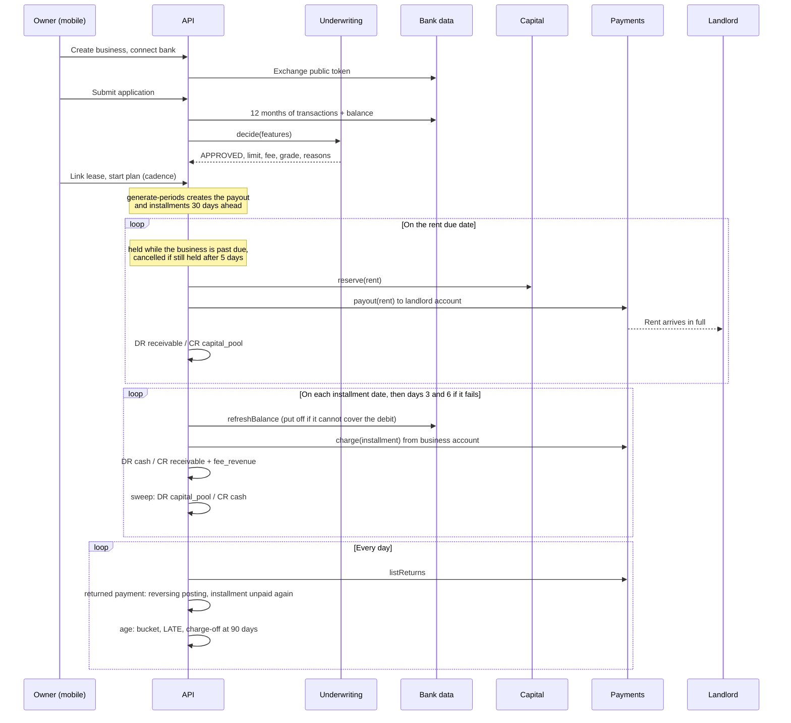

# Architecture

CashFlow is a pnpm and Turborepo monorepo with three apps and one shared package. This
document covers how the pieces fit, the provider seams where real money would plug in,
the ledger, and the life of a rent payment. For the underwriting model see
[`apps/api/UNDERWRITING.md`](apps/api/UNDERWRITING.md).

## Packages

| Path              | What it is                                                                                                                                                                                        |
| ----------------- | ------------------------------------------------------------------------------------------------------------------------------------------------------------------------------------------------- |
| `packages/shared` | Zod schemas for every request and response, enums, brand tokens, and the pure installment math. Exported as TypeScript source; each consumer compiles it. No runtime dependency other than `zod`. |
| `apps/api`        | Fastify 5 with `fastify-type-provider-zod`, Prisma 7 on Postgres, pino logging, OpenAPI at `/docs`. Owns all business rules.                                                                      |
| `apps/mobile`     | Expo app for business owners. Thin client: validates server responses with the shared schemas and renders them.                                                                                   |
| `apps/web`        | One page marketing site, statically exported and hosted on Vercel.                                                                                                                                |

Shared contracts are the spine. A schema is added to `packages/shared` first, the API
validates with it on both input and output, and the mobile app parses responses with the
same schema. A field that is not in the schema does not exist.

## Conventions that keep money honest

- **Integer cents everywhere.** No floats touch an amount. Rates are basis points.
- **Calendar dates are strings.** Due dates and periods are `YYYY-MM-DD` and compare
  lexicographically. There is no timezone bug to have because there is no Date object.
- **Every money movement posts a balanced ledger transaction** in the same database
  transaction as the status change it records. The service refuses unbalanced entries.
- **Jobs are idempotent.** Running a job twice for the same day is a no-op the second time,
  enforced by status checks and ledger idempotency keys.

## Provider seams

Every external dependency that touches money or risk sits behind an interface in
`apps/api/src/providers/<name>/`. The implementation is chosen by an environment variable
and the sandbox implementation is always the default. Nothing in this repository can move
real funds without someone deliberately configuring it to.

| Provider               | Interface                                                 | Default                                                                  | Real world                                                                          |
| ---------------------- | --------------------------------------------------------- | ------------------------------------------------------------------------ | ----------------------------------------------------------------------------------- |
| `UnderwritingProvider` | `decide(input) -> decision`                               | `cashflow`: the in-house cash flow engine, deterministic and explainable | The same engine on real bank data, optionally blended with a bureau or vendor score |
| `BankLinkProvider`     | link token, exchange public token, balances, transactions | `mock`: deterministic synthetic histories by token keyword               | Plaid, MX, Finicity. A `plaid.ts` skeleton shows the shape                          |
| `PaymentsProvider`     | `charge`, `payout`, idempotent by key; `listReturns`      | `mock`: succeeds unless the token says `fail` or `return_r01` and so on  | Stripe, Modern Treasury, Increase. A `stripe.ts` skeleton shows the shape           |
| `CapitalProvider`      | `availableCents`, `reserve`, `fund`                       | `mock`: a pool that lives in the ledger                                  | A credit facility, a warehouse line, or a fund                                      |

### How a real capital source plugs in

The capital pool is the part that makes this a business rather than a demo. In the sandbox
it is a ledger account, `capital_pool`, seeded with $250,000 of `pool_equity`. Payouts draw
it down and collections sweep cash back into it.

A production `CapitalProvider` would implement the same three methods against a facility:

1. `availableCents()` reads undrawn capacity from the facility, net of concentration limits
   and any reserve requirement.
2. `reserve(amountCents, reference)` draws against the facility for a specific payout and
   returns a reference, or throws `InsufficientCapitalError`, in which case the payout is
   marked `FAILED` with the reason and tried again on the next run, for as long as it is
   inside its release window (see "Holds" below). Nothing else in the system changes.
3. `fund(amountCents)` records a capital contribution or facility draw as `pool_equity` so
   the ledger still balances.

The ledger does not care where the money came from. A facility provider posts the same
entries as the mock; the difference is that `reserve` has a real counterparty. Collections
sweep cash into `capital_pool` on the same schedule, and the fee stays in `fee_revenue`,
which is what pays the facility's interest and the company's costs.

## Ledger

Five account types. Seven system accounts plus one receivable per business:

| Code                      | Type           | Meaning                                                     |
| ------------------------- | -------------- | ----------------------------------------------------------- |
| `capital_pool`            | Asset          | Cash available to front rent                                |
| `cash`                    | Asset          | Installments collected, not yet swept                       |
| `receivable:<businessId>` | Asset          | Rent fronted for a business, not yet repaid or written off  |
| `allowance:credit_losses` | Asset (contra) | The part of receivables not expected back. A credit balance |
| `fee_revenue`             | Revenue        | Fees collected                                              |
| `recovery_income`         | Revenue        | Principal collected on balances already written off         |
| `provision_expense`       | Expense        | Cost of building the allowance                              |
| `pool_equity`             | Equity         | Capital contributed to the pool                             |

Net receivables are the receivable accounts less the allowance. The allowance is typed as an
asset with a credit balance, so its natural balance reads negative and adding it to the
receivables gives the net figure.

| Event                                      | Debit                     | Credit                                              |
| ------------------------------------------ | ------------------------- | --------------------------------------------------- |
| Pool funded                                | `capital_pool`            | `pool_equity`                                       |
| Landlord paid                              | `receivable:<biz>`        | `capital_pool`                                      |
| Installment collected                      | `cash` (total)            | `receivable:<biz>` (principal), `fee_revenue` (fee) |
| Cash swept                                 | `capital_pool`            | `cash`                                              |
| Collected installment returned by the bank | mirror of the collection  | mirror of the collection                            |
| Returned payments covered from the pool    | `cash`                    | `capital_pool`                                      |
| Landlord payout returned by the bank       | `capital_pool`            | `receivable:<biz>`                                  |
| Monthly provision, allowance built         | `provision_expense`       | `allowance:credit_losses`                           |
| Monthly provision, allowance released      | `allowance:credit_losses` | `provision_expense`                                 |
| Charge-off                                 | `allowance:credit_losses` | `receivable:<biz>` (unpaid principal)               |
| Payment on a written off installment       | `cash` (total)            | `recovery_income` (principal), `fee_revenue` (fee)  |

Rules the postings follow:

- **Append only.** Database triggers reject UPDATE and DELETE on ledger rows. A return is
  undone by posting the mirror image of the original transaction (`reverseTransaction`), never
  by editing it.
- **A fee is revenue only when it is collected.** An unpaid fee is never booked, so a
  charge-off writes off principal only and books no fee revenue and no fee loss.
- **A charge-off never takes the allowance below zero.** If the allowance is short of the
  principal being written off, the same database transaction first tops it up with
  DR `provision_expense` / CR `allowance:credit_losses`.
- **Two dates.** `postedAt` is when the row was written. `effectiveDate` is the calendar
  date the movement belongs to: the job's as-of date, or the date a return arrived. They
  differ when history is replayed with `job:run --as-of`, as the seed does.
- **One posting per business event**, enforced by idempotency keys: `payout:<id>`,
  `repayment:<id>` (an installment whose payment was returned is collected again, which is a
  second repayment and a second posting), `repayment:<id>:return`, `payout:<id>:return`,
  `provision:<YYYY-MM>`, `charge_off:<planId>:<date>`.

Balances are derived by summing entries, never stored. `GET /v1/admin/ledger/trial-balance`
proves debits equal credits at any moment, and the integration tests assert it after every
lifecycle step. `GET /v1/admin/delinquency` reports receivables, the allowance, charge-offs
and recoveries to date, and plans and principal by delinquency bucket.

## The life of a rent payment

### Servicing policy

Everything that happens after a landlord payout follows one object,
`ACTIVE_SERVICING_POLICY` in `apps/api/src/servicing/policy.ts`: pure functions with no
database or clock. The services ask it when to debit, when to hold a payout, which bucket a
plan is in, how much to reserve, and when to write off. The portfolio simulator in
`apps/api/src/evals/` calls the same functions, so the policy that is evaluated is the policy
that runs.

| Rule                | Standard policy                                                                                                     |
| ------------------- | ------------------------------------------------------------------------------------------------------------------- |
| Grace               | 3 days. An installment is `LATE` from day 4                                                                         |
| Delinquency buckets | `CURRENT` (nothing past due), `GRACE` (1 to 3 days), `DELINQUENT` (4 to 29), `DEFAULT` (30 and over), `CHARGED_OFF` |
| Collection attempts | At most 3 per installment per bank account, on days 0, 3, and 6                                                     |
| Balance check       | Before each scheduled debit. A debit the balance cannot cover is put off a day and is not an attempt                |
| Stop-advance        | The next landlord payout is held while anything is more than 3 days past due                                        |
| Release window      | A payout not paid within 5 days of its scheduled date is cancelled, never paid late                                 |
| Charge-off          | At 90 days past due. The whole unpaid balance is written off and the plan is closed                                 |
| Reserve rates       | 0.40% of current principal, 85% of grace, 95% of delinquent, 100% of default. Measured in the evals                 |
| Return codes        | Retryable (R01, R09), hard (R02, R03, R04, R08, R13, R16, R20), unauthorized (R05, R07, R10, R29)                   |

Days past due is the age of a plan's oldest unpaid installment. It is derived from the
installments on every read and never stored, because it changes at midnight without any
event. The bucket is stored on the plan (`RentPlan.delinquencyStatus`), because a change of
bucket is an event: it is audited, provisioning reserves by it, and the ops summary groups by
it.

### Holds

A payout that falls due is paid, held, or cancelled by `processPayout`:

- It is **held** (`HELD`, with a reason the owner sees through `GET /v1/rent-plans/:id`)
  while the business is more than 3 days past due on rent already fronted, on any of its
  plans (`PAST_DUE`); while the plan is frozen by a periodic review, an unauthorized return,
  or a returned payout (`ADVANCE_FROZEN`); or while the owner has paused the plan
  (`PLAN_PAUSED`).
- A held payout is **released** and paid as soon as nothing holds it, if that is within 5
  days of its scheduled date. Its installments move out by the number of days it was late.
- After 5 days it is **cancelled** and its installments are voided. A month the tenant has
  had to settle with the landlord directly is never paid late, and a month that went by while
  a plan was paused or frozen is never generated afterwards.
- A payout that fails for lack of capital or at the provider is `FAILED` and retried on each
  run inside the same 5 days, then cancelled.

Pausing a plan stops new rent periods. It does not stop collection: installments on rent
already paid to the landlord are debited on schedule whether the plan is active, paused, or
closed. A freeze is lifted only by a reviewer, with
`POST /v1/admin/rent-plans/:id/release-freeze`.

### Collections and returns

`collectInstallment` asks the policy whether a debit is scheduled today. Before debiting it
reads the balance through the bank link provider; a debit that would obviously fail is put
off to the next run, the reason is recorded on the installment, and no attempt is used. Each
debit that is presented counts, whether it fails on the spot or comes back later. After the
third the installment is debited no more and waits for a manual payment
(`POST /v1/repayments`), which works for a late, defaulted, or written off balance.

A bank debit is booked when it is made and can come back afterwards. There are no webhooks:
`reconcile-payments` polls `PaymentsProvider.listReturns` and, in one database transaction
per return, marks the repayment `RETURNED`, makes the installment unpaid again, and posts the
reversing ledger transaction. What happens next depends on the class of the code:

| Class        | Codes                             | Effect beyond the reversal                                                                                   |
| ------------ | --------------------------------- | ------------------------------------------------------------------------------------------------------------ |
| Retryable    | R01, R09                          | None. The return counted as an attempt and the retry schedule continues                                      |
| Hard         | R02, R03, R04, R08, R13, R16, R20 | The bank link is disabled. No automatic debit until the business links an account again                      |
| Unauthorized | R05, R07, R10, R29                | The same, and the plan is frozen from further advances, and a high severity `UNAUTHORIZED_RETURN` is written |

A returned payment never counts as on time: a period with any returned payment does not move
a business up the limit ladder, even if it was collected again inside grace.

A landlord payout can come back too, from a closed or wrong account. The pool gets the rent
back and the receivable is taken off with a reversing posting, the payout is `FAILED` with
the code, installments not yet collected are voided, and the plan is frozen. Principal
already collected for that month is left as a credit on the business's receivable account
and reported in the `PAYOUT_RETURNED` audit event so that it can be refunded.

The mock payments provider produces all of this from token keywords: `fail` rejects on the
spot, `return_r01` accepts and returns two days later with that code, `late_return_r10`
returns three weeks later, and `_once` limits it to the first payment on the token.

### Charge-off and recovery

When a plan's oldest unpaid installment reaches 90 days past due, `age-receivables` writes
off everything the plan still owes: DR `allowance:credit_losses` / CR the receivable for the
unpaid principal, the installments become `CHARGED_OFF`, payouts not yet made are cancelled,
the plan is `CLOSED` with bucket `CHARGED_OFF`, the business is `SUSPENDED`, and its other
plans are frozen. A written off installment is still owed. If it is paid later, by a manual
payment, the principal is booked to `recovery_income` and the plan stays closed.

### Jobs

Seven jobs in `apps/api/src/jobs/` run in this order, on a cron inside the API process
(`JOBS_ENABLED=true`) or by hand with `pnpm --filter @cashflow/api job:run --as-of
YYYY-MM-DD`. Each is idempotent for a given date:

1. **reunderwrite** re-scores each active plan once a month and freezes one that has
   deteriorated. First, so a plan it freezes gets no new period and no payout the same day.
2. **reconcile-payments** polls for returned payments and undoes each one. Before anything
   reads who is paid up.
3. **age-receivables** recomputes every plan's delinquency bucket, marks installments
   `LATE` once past grace whether or not a debit was attempted, writes an audit event on
   every change of bucket, and charges off plans at 90 days.
4. **generate-periods** creates next month's landlord payout and its installments for every
   active plan that is not frozen, 30 days before the due date, using
   `buildInstallmentSchedule` from `packages/shared`.
5. **process-payouts** pays, holds, releases, or cancels every payout that is due: reserve
   capital, call the payments provider, post the ledger, mark `PAID`. A capital shortfall or
   a provider failure marks the payout `FAILED` with the reason and it is tried again on the
   next run.
6. **collect-installments** makes the debits the policy schedules for today on every
   installment whose payout has been paid, posts the ledger, and settles operating cash with
   the pool.
7. **provision** sets the allowance to the policy's reserve on outstanding principal by
   bucket and posts the change. It posts on the first run of each calendar month only.

Each run records a `JobRun` row with a summary so a dashboard or an on-call engineer can see
what happened on any given day.

## Installment math

`buildInstallmentSchedule({ rentCents, feeBps, dueDate, installmentsPerMonth })` lives in
`packages/shared/src/money/schedule.ts` and is used by the API to create installments and by
the mobile app to preview them before a plan exists. The first installment is collected on
the rent due date and the rest follow the semi-monthly convention: two weeks apart for two
installments (the 1st and the 15th for rent due on the 1st), one week apart for four.
Principal and fee are split with `splitCents` so rounding remainders land on the last
installment and the sum is exact. Underwriting may recommend four installments for businesses
with daily deposits and a thin buffer.

## Auth

Email and password, self contained. Passwords are hashed with Node's `scrypt`. Access tokens
are 15 minute HS256 JWTs; refresh tokens live 30 days, are stored as SHA-256 hashes, and are
rotated on every use so a leaked refresh token can be used at most once. The mobile app keeps
both in `expo-secure-store` and refreshes transparently on a 401.

## Testing

- `packages/shared`: unit tests for schedule math (short months, rounding, cadence).
- `apps/api`: unit tests for the ledger invariants, password hashing, underwriting features,
  scorecard, and engine scenarios; integration tests against a real Postgres for auth,
  underwriting outcomes, and the full payout and collection lifecycle including capital
  shortfall recovery, failed collections, late marking, and early payment. Servicing is
  tested by running the jobs across simulated dates: cure inside grace, the retry cap and
  manual payment, payouts held, released, and cancelled, paused plans, returned payments and
  payouts, aging to charge-off at day 90, provisioning, and recovery. Every step runs the
  jobs twice to prove the second run changes nothing, and checks the trial balance.
- `apps/mobile`: unit tests for input parsing and the onboarding stage machine.

CI runs lint, typecheck, and all tests on every push with a Postgres service container.

## Deploying

The API ships as a Docker image (`apps/api/Dockerfile`) and runs migrations on start. Notes
for Fly.io and Render are in `apps/api/DEPLOY.md`. The marketing site deploys to Vercel from
`apps/web`. The mobile app builds with EAS or `expo run` like any Expo project; point it at
the API with `EXPO_PUBLIC_API_URL`.
