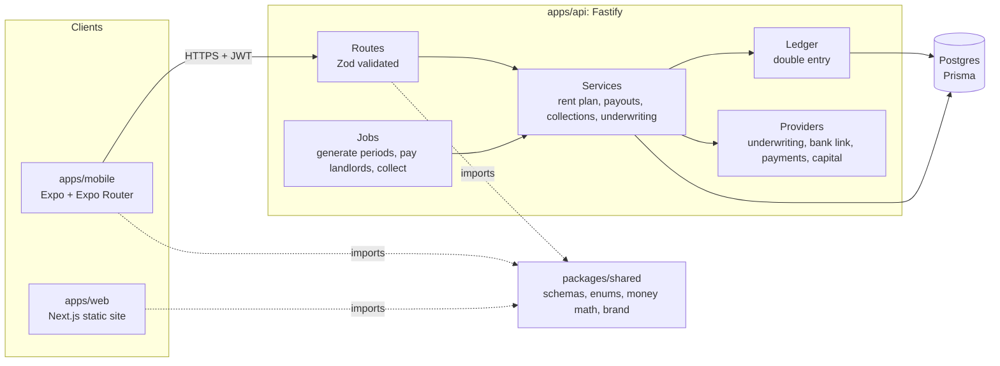
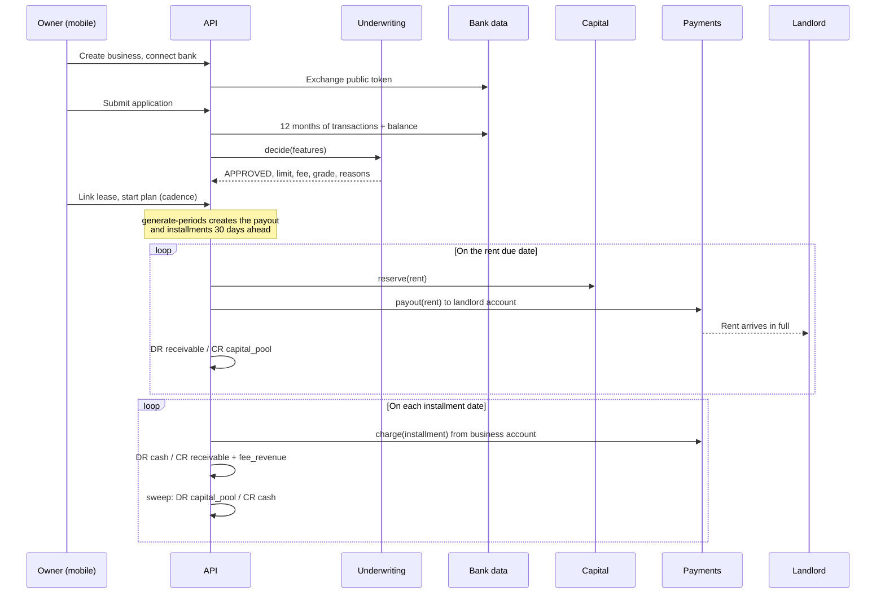

# Architecture

CashFlow is a pnpm and Turborepo monorepo with three apps and one shared package. This
document covers how the pieces fit, the provider seams where real money would plug in,
the ledger, and the life of a rent payment. For the underwriting model see
[`apps/api/UNDERWRITING.md`](apps/api/UNDERWRITING.md).

## Packages

| Path              | What it is                                                                                                                                                                                        |
| ----------------- | ------------------------------------------------------------------------------------------------------------------------------------------------------------------------------------------------- |
| `packages/shared` | Zod schemas for every request and response, enums, brand tokens, and the pure installment math. Exported as TypeScript source; each consumer compiles it. No runtime dependency other than `zod`. |
| `apps/api`        | Fastify 5 with `fastify-type-provider-zod`, Prisma 7 on Postgres, pino logging, OpenAPI at `/docs`. Owns all business rules.                                                                      |
| `apps/mobile`     | Expo app for business owners. Thin client: validates server responses with the shared schemas and renders them.                                                                                   |
| `apps/web`        | One page marketing site, statically exported and hosted on Vercel.                                                                                                                                |

Shared contracts are the spine. A schema is added to `packages/shared` first, the API
validates with it on both input and output, and the mobile app parses responses with the
same schema. A field that is not in the schema does not exist.

## Conventions that keep money honest

- **Integer cents everywhere.** No floats touch an amount. Rates are basis points.
- **Calendar dates are strings.** Due dates and periods are `YYYY-MM-DD` and compare
  lexicographically. There is no timezone bug to have because there is no Date object.
- **Every money movement posts a balanced ledger transaction** in the same database
  transaction as the status change it records. The service refuses unbalanced entries.
- **Jobs are idempotent.** Running a job twice for the same day is a no-op the second time,
  enforced by status checks and ledger idempotency keys.

## Provider seams

Every external dependency that touches money or risk sits behind an interface in
`apps/api/src/providers/<name>/`. The implementation is chosen by an environment variable
and the sandbox implementation is always the default. Nothing in this repository can move
real funds without someone deliberately configuring it to.

| Provider               | Interface                                                 | Default                                                                  | Real world                                                                          |
| ---------------------- | --------------------------------------------------------- | ------------------------------------------------------------------------ | ----------------------------------------------------------------------------------- |
| `UnderwritingProvider` | `decide(input) -> decision`                               | `cashflow`: the in-house cash flow engine, deterministic and explainable | The same engine on real bank data, optionally blended with a bureau or vendor score |
| `BankLinkProvider`     | link token, exchange public token, balances, transactions | `mock`: deterministic synthetic histories by token keyword               | Plaid, MX, Finicity. A `plaid.ts` skeleton shows the shape                          |
| `PaymentsProvider`     | `charge`, `payout`, idempotent by key                     | `mock`: succeeds unless the token contains `fail`                        | Stripe, Modern Treasury, Increase. A `stripe.ts` skeleton shows the shape           |
| `CapitalProvider`      | `availableCents`, `reserve`, `fund`                       | `mock`: a pool that lives in the ledger                                  | A credit facility, a warehouse line, or a fund                                      |

### How a real capital source plugs in

The capital pool is the part that makes this a business rather than a demo. In the sandbox
it is a ledger account, `capital_pool`, seeded with $250,000 of `pool_equity`. Payouts draw
it down and collections sweep cash back into it.

A production `CapitalProvider` would implement the same three methods against a facility:

1. `availableCents()` reads undrawn capacity from the facility, net of concentration limits
   and any reserve requirement.
2. `reserve(amountCents, reference)` draws against the facility for a specific payout and
   returns a reference, or throws `InsufficientCapitalError` so the payout is left
   `SCHEDULED` and retried tomorrow. Nothing else in the system changes.
3. `fund(amountCents)` records a capital contribution or facility draw as `pool_equity` so
   the ledger still balances.

The ledger does not care where the money came from. A facility provider posts the same
entries as the mock; the difference is that `reserve` has a real counterparty. Collections
sweep cash into `capital_pool` on the same schedule, and the fee stays in `fee_revenue`,
which is what pays the facility's interest and the company's costs.

## Ledger

Five account types, five system accounts plus one receivable per business:

| Code                      | Type    | Meaning                                     |
| ------------------------- | ------- | ------------------------------------------- |
| `capital_pool`            | Asset   | Cash available to front rent                |
| `cash`                    | Asset   | Installments collected, not yet swept       |
| `receivable:<businessId>` | Asset   | Rent fronted for a business, not yet repaid |
| `fee_revenue`             | Revenue | Fees earned                                 |
| `pool_equity`             | Equity  | Capital contributed to the pool             |

| Event                 | Debit              | Credit                                              |
| --------------------- | ------------------ | --------------------------------------------------- |
| Pool funded           | `capital_pool`     | `pool_equity`                                       |
| Landlord paid         | `receivable:<biz>` | `capital_pool`                                      |
| Installment collected | `cash` (total)     | `receivable:<biz>` (principal), `fee_revenue` (fee) |
| Cash swept            | `capital_pool`     | `cash`                                              |

Balances are derived by summing entries, never stored. `GET /v1/admin/ledger/trial-balance`
proves debits equal credits at any moment, and the integration tests assert it after every
lifecycle step.

## The life of a rent payment

Three jobs in `apps/api/src/jobs/` run on a cron inside the API process
(`JOBS_ENABLED=true`) or by hand with `pnpm --filter @cashflow/api job:run --as-of
YYYY-MM-DD`:

1. **generate-periods** creates next month's landlord payout and its installments for every
   active plan, 30 days before the due date, using `buildInstallmentSchedule` from
   `packages/shared`.
2. **process-payouts** pays every payout scheduled for today or earlier: reserve capital,
   call the payments provider, post the ledger, mark `PAID`. A capital shortfall leaves the
   payout `SCHEDULED` for tomorrow; a provider failure marks it `FAILED` with the reason.
3. **collect-installments** charges every installment due today or earlier whose payout has
   been paid, posts the ledger, and sweeps collected cash back to the pool. A failed charge
   is retried daily and marked `LATE` after a three day grace period.

Each run records a `JobRun` row with a summary so a dashboard or an on-call engineer can see
what happened on any given day.

## Installment math

`buildInstallmentSchedule({ rentCents, feeBps, dueDate, installmentsPerMonth })` lives in
`packages/shared/src/money/schedule.ts` and is used by the API to create installments and by
the mobile app to preview them before a plan exists. The first installment is collected on
the rent due date and the rest are spaced evenly across the period; principal and fee are
split with `splitCents` so rounding remainders land on the last installment and the sum is
exact. With two installments in a 30 day month that is the due date and the due date plus 15
days. Underwriting may recommend four installments for businesses with daily deposits and a
thin buffer.

## Auth

Email and password, self contained. Passwords are hashed with Node's `scrypt`. Access tokens
are 15 minute HS256 JWTs; refresh tokens live 30 days, are stored as SHA-256 hashes, and are
rotated on every use so a leaked refresh token can be used at most once. The mobile app keeps
both in `expo-secure-store` and refreshes transparently on a 401.

## Testing

- `packages/shared`: unit tests for schedule math (short months, rounding, cadence).
- `apps/api`: unit tests for the ledger invariants, password hashing, underwriting features,
  scorecard, and engine scenarios; integration tests against a real Postgres for auth,
  underwriting outcomes, and the full payout and collection lifecycle including capital
  shortfall recovery, failed collections, late marking, and early payment.
- `apps/mobile`: unit tests for input parsing and the onboarding stage machine.

CI runs lint, typecheck, and all tests on every push with a Postgres service container.

## Deploying

The API ships as a Docker image (`apps/api/Dockerfile`) and runs migrations on start. Notes
for Fly.io and Render are in `apps/api/DEPLOY.md`. The marketing site deploys to Vercel from
`apps/web`. The mobile app builds with EAS or `expo run` like any Expo project; point it at
the API with `EXPO_PUBLIC_API_URL`.
