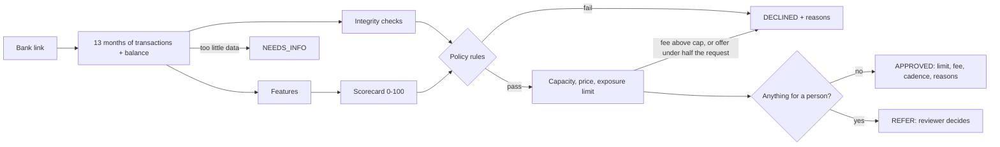

# Cash flow underwriting

CashFlow decides whether to front a business's rent by reading its bank account, not its
credit score. The engine lives in `src/underwriting/` and is pure TypeScript: given a year
of transactions and a current balance it produces a score, a grade, a limit, a fee, and a
list of reasons an applicant can read. No network, no model weights, no hidden state.

This document explains the model so it can be reviewed, argued with, and changed.

## Why cash flow and not credit

Small businesses are thin files. Many have no business credit history, the owner's
personal score says little about the shop's ability to pay rent, and collateral is rarely
available. What every operating business does have is a bank account that shows exactly
how much comes in, how much goes out, when, and how close to the edge it runs. Rent is a
monthly obligation, so the question underwriting must answer is narrow: after everything
else this business pays, is there reliably enough cash on the right days to repay a month's
rent plus a small fee?

## Policy versions

Every number the engine uses lives on a `CreditPolicy` object in `src/underwriting/policy.ts`:
cutoffs, scorecard weights, grade floors, pricing, integrity thresholds, exposure caps, and the
triggers that send an application to a reviewer. `decide(input, policy)` takes the policy as an
argument and defaults to `CURRENT_POLICY`.

| Version       | Status  | What it is                                                                                                |
| ------------- | ------- | --------------------------------------------------------------------------------------------------------- |
| `cashflow-v1` | Retired | The launch policy. Kept as `POLICY_V1` so the portfolio evals can run it beside the current one.          |
| `cashflow-v2` | Current | Integrity checks, earlier decline detection, expected loss pricing, exposure rules, and manual referrals. |

Every stored decision carries the `policyVersion` that made it and a `snapshot`: a summary of
the inputs, the thresholds in force, the integrity flags, the fee build up with PD and
expected loss, the caps on the limit, and the referral triggers. The snapshot is internal. The
applicant facing serializers never include it, and PD tables, weights, and cutoffs are not
exposed through the public API.

Decisions are append-only. An application can have several: the first answer, a resubmission
after more information, a reviewer's outcome, and monthly periodic reviews once a plan runs.
Nothing is deleted. A new decision sets `supersededAt` on the one before it, a partial unique
index allows only one current decision per application, and every reader goes through
`CURRENT_DECISION` in `src/services/decisions.ts`.

Changing a policy number is a policy change: give the policy a new version, rerun
`pnpm --filter @cashflow/api eval:portfolio`, and ship only if the gates pass. The measured
effect of version 2 is in `evals/report.md`.

## Pipeline

1. **Bank data.** `services/underwriting.ts` asks the `BankLinkProvider` for 400 days of
   transactions and the current balance: a little over a year, so the last four weeks can be
   compared with the same weeks a year earlier. Categories are normalized to the
   `TransactionCategory` enum in `packages/shared` so the engine does not care which bank
   data vendor produced them.
2. **Lookups.** The service also gathers what the pure rules cannot see: what the business
   already has with us, what its industry and the pool hold (`services/portfolio-state.ts`),
   and whether the same bank account, landlord account, or business identity appears under
   another user.
3. **Features** (`features.ts`). Transactions are bucketed into full calendar months and
   daily balances are reconstructed backward from the current balance. Credits the integrity
   checks matched to a same sized transfer out are left out of revenue.
4. **Integrity checks** (`integrity.ts`). Can the numbers be trusted. See below.
5. **Scorecard** (`scorecard.ts`). Eight factors, weights summing to 100, piecewise linear
   curves. Every factor emits a human readable reason tagged positive, negative, or
   informational.
6. **Policy rules** (`engine.ts`). Hard rules that decline regardless of score.
7. **Capacity, price, and limit**, solved together (`pricing.ts`, `exposure.ts`).
8. **Escalation.** Anything a person should look at becomes a `REFER`. Clean applications are
   decided in the same request.

## Features

All money is integer cents and all ratios are basis points, so a stored decision is exact
and reproducible.

| Feature                       | Definition                                                                                                                                                                                      |
| ----------------------------- | ----------------------------------------------------------------------------------------------------------------------------------------------------------------------------------------------- |
| Verified monthly revenue      | Mean of operating inflows over the last three full months. Card settlements, cash deposits, invoice payments, and other income, net of refunds. Transfers in and loan proceeds are excluded.    |
| Revenue growth                | Last three months versus the prior three. Requires six months.                                                                                                                                  |
| Revenue trend                 | On daily windows of whole weeks: trailing 4 weeks against the 12 before, trailing 12 against the 12 before, trailing 4 against the same 4 a year earlier, and the slope of the last six months. |
| Revenue volatility            | Coefficient of variation of monthly revenue.                                                                                                                                                    |
| Deposit days per month        | Distinct days with an operating inflow. A proxy for how continuously the business sells.                                                                                                        |
| Operating outflows and margin | Payroll, rent, suppliers, utilities, insurance, tax, software, fees. Margin is revenue minus operating outflows over revenue.                                                                   |
| Net cash flow                 | Revenue minus operating outflows, debt service, and owner draws.                                                                                                                                |
| Debt service                  | Loan and merchant cash advance payments per month, and as a share of revenue.                                                                                                                   |
| Observed rent                 | The recurring rent debit already in the account. Once CashFlow pays the landlord this cash is freed up, so it counts toward repayment capacity.                                                 |
| Days of cash on hand          | Current balance divided by average daily outflows over 90 days.                                                                                                                                 |
| Low point of the buffer       | The lowest balance of the last 90 days, in days of average outflows.                                                                                                                            |
| Conduct                       | NSF fees and negative balance days in the last 90 days, plus NSF fees over the year.                                                                                                            |
| Rent to revenue               | Requested rent over verified revenue. The payment to income ratio of this product.                                                                                                              |
| Coverage                      | Free cash (net cash flow plus observed rent) over rent plus fee, times 100. Scored without the fee, stored at the fee quoted. See "Coverage and the fee".                                       |
| Stated variance               | How far the applicant's stated revenue sits above what the bank shows.                                                                                                                          |

## Scorecard

| Factor             | v1 weight | v2 weight | Full marks                                         | Zero                                   |
| ------------------ | --------: | --------: | -------------------------------------------------- | -------------------------------------- |
| Rent affordability |        20 |        10 | Rent at or under 10% of verified revenue           | 35% or more                            |
| Cash flow coverage |        20 |        15 | Free cash covers the rent 2.0x                     | Under 1.0x                             |
| Cash buffer        |        15 |        30 | 60 or more days on hand, never under 30 in 90 days | Under 7 days, and a low point of zero  |
| Account conduct    |        15 |        15 | No NSF fees or negative days                       | 6 points per NSF, 1.5 per negative day |
| Revenue stability  |        10 |        10 | Month to month variation at or under 15%           | 60% or more                            |
| Revenue trend      |        10 |        10 | Up 10% or more                                     | Down 30% or more                       |
| Existing debt      |         5 |         5 | Debt service at or under 3% of revenue             | 20% or more                            |
| Bank history       |         5 |         5 | 12 months reviewed                                 | 3 months or fewer                      |

Grades: A at 80 or above, B at 68, C at 55, D at 45, F below 45.

What version 2 changed in the scorecard, and why:

- **Weight moved from rent share to the cash buffer.** Under the standard servicing policy a
  default is a liquidity event: a debit fails on the day the balance is short. In the
  simulation, bad rate among funded plans fell from 21% under 7 days of cash to 3% at 60 or
  more, while it was flat across rent share (5.4% to 5.7% from under 8% of revenue to over
  20%), because rent share is already bounded by the hard cap and by capacity.
- **The buffer factor blends in the low point of the last 90 days** (40% of the factor). A
  balance that is healthy today but touched zero last month is thin.
- **Conduct also counts overdraft fees earlier in the year**, one point each.
- **The trend factor reads the season adjusted trend**: the trailing four weeks against the
  same weeks a year earlier when the history allows, otherwise the trailing twelve weeks
  against the twelve before.

These weights were chosen by looking at which factors separated good plans from bad in the
synthetic population. They are judgment informed by a simulation, not coefficients fitted to
real repayment, and they need refitting on real outcomes. A logistic regression on thirty
features fitted to the same simulation ranked the funded book only about 0.02 of AUC better,
which was not worth fitting a scorecard to synthetic data.

### Coverage and the fee

Version 1 scored every applicant's coverage at a flat 2.5% fee, whatever fee they were later
quoted. From version 2 the scored ratio is free cash over rent alone. The fee is set from the
score, so a score that depends on the fee is circular, and scoring it in two passes does not
settle: a second pass can move the score into another band, which changes the fee again. The
fee is at most 4% of rent, so leaving it out moves coverage by at most 4%. The fee is applied
exactly where it binds: capacity leaves room for rent plus the fee actually quoted, and the
coverage ratio stored on the decision is restated at that fee.

## Integrity checks

The scorecard asks whether a business can afford the rent. The integrity checks ask whether
the numbers in front of the scorecard can be trusted. Each is a pure function in
`integrity.ts` returning at most one flag, and what a flag does is fixed in one table,
`INTEGRITY_RULES`:

| Flag                                | Fires when                                                                                            | Action     |
| ----------------------------------- | ----------------------------------------------------------------------------------------------------- | ---------- |
| `STATED_REVENUE_FAR_ABOVE_VERIFIED` | Stated revenue more than 50% above verified                                                           | Needs info |
| `STATED_REVENUE_ABOVE_VERIFIED`     | More than 25% above                                                                                   | Inform     |
| `STATED_REVENUE_BELOW_VERIFIED`     | More than 40% below                                                                                   | Inform     |
| `POS_DEPOSIT_SHORTFALL`             | Bank deposits under 70% of point of sale net sales                                                    | Inform     |
| `POS_DEPOSIT_EXCESS`                | Bank deposits over 150% of point of sale net sales                                                    | Refer      |
| `ROUND_TRIP_DEPOSITS`               | 3 or more credits each matched by a transfer out of the same size within 4 days, 10% or more of sales | Knockout   |
| `ROUND_TRIP_SUSPECTED`              | 2 or more such matches, 3% or more of sales                                                           | Refer      |
| `NON_SALES_CREDIT_SHARE`            | Transfers in and loan proceeds over 30% of all credits in 90 days                                     | Refer      |
| `OWNER_TOP_UPS_BEFORE_APPLYING`     | Transfers in over 10% of monthly revenue in the last 30 days, concentrated there                      | Inform     |
| `REVENUE_SPIKE`                     | Last six weeks more than 75% above the twenty before, and last year does not explain it               | Refer      |
| `SHORT_ACCOUNT_HISTORY`             | Account history more than 3 months shorter than time in business (capped at a year)                   | Refer      |
| `RENT_ABOVE_OBSERVED`               | Requested rent more than 1.2 times the rent seen in the account                                       | Cap        |
| `NO_RENT_OBSERVED`                  | No rent payments in the account                                                                       | Refer      |
| `LANDLORD_IS_APPLICANT_ACCOUNT`     | A lease's landlord payout account is one of the business's own linked accounts                        | Knockout   |
| `DUPLICATE_LANDLORD_ACCOUNT`        | Another user's business pays the same landlord account                                                | Inform     |
| `DUPLICATE_BANK_ACCOUNT`            | Another user's business linked the same bank account                                                  | Refer      |
| `DUPLICATE_BUSINESS_IDENTITY`       | Another user has a business with the same legal name and address                                      | Refer      |

- **Knockout** declines, with a reason the applicant can read.
- **Needs info** asks the applicant for something specific.
- **Refer** sends the application to a reviewer.
- **Cap** holds the limit down (see exposure rules) and does nothing else.
- **Inform** is recorded on the decision for reviewers and monitoring and does not change the
  outcome.

The rule of thumb: decline automatically only on a pattern with no innocent reading. A wrong
automatic decline for suspected fraud is the most expensive mistake to make to an honest
applicant, so anything a legitimate business could show goes to a person or only limits the
amount.

Credits matched as round trips are left out of revenue whether or not the pattern is strong
enough to flag, so padded deposits cannot buy a larger limit.

The last four flags need the database. The service looks the facts up and passes them to the
engine as `integrityContext`. The landlord check also runs when a plan is opened, because the
lease is usually linked after the decision.

Flags, their details, and the referral triggers are internal. They appear in the decision
snapshot and the operator review queue, never in what the applicant sees.

## Policy rules

Applied after scoring. Any one of these declines the application, and the scorecard
reasons are still returned so the applicant sees the full picture.

- Fewer than 6 months in business (self reported).
- Verified revenue under $5,000 a month.
- More than 2 NSF fees in the last 90 days.
- More than 10 negative balance days in the last 90 days.
- Requested rent above 40% of verified revenue.
- Revenue down more than 25% quarter over quarter.
- Earlier decline detection (version 2, below).
- No positive free cash flow after expenses, owner draws, and existing debt.
- Score below 50 (45 under version 1).
- An integrity knockout.

Missing information is never a decline. These return NEEDS_INFO with a specific ask:

- No bank account connected.
- Fewer than 6 full months of transactions in the connected account.
- Stated revenue more than 50% above verified revenue. The applicant is asked to connect
  other accounts that receive revenue or correct the figure.

### The cutoff, and grade D

The minimum score is the lowest five point band that kept a positive net margin under mild
stress in two independent 10,000 applicant runs under the standard servicing policy:

| Score band | Bad rate, base | Bad rate, mild stress | Net margin, mild stress | Customers profitable, mild |
| ---------- | -------------: | --------------------: | ----------------------: | -------------------------: |
| 45 to 49   |     29% to 35% |            52% to 58% |           -18 to 12 bps |                 46% to 48% |
| 50 to 54   |     20% to 24% |            37% to 39% |            65 to 76 bps |                 64% to 65% |
| 55 to 59   |     17% to 19% |            24% to 29% |            80 to 98 bps |                 71% to 76% |

So the cutoff is 50. The lower half of grade D is declined. The upper half (50 to 54) is
approvable, but never automatically: a score fewer than 5 points above the cutoff is referred
to a reviewer. That band is where the model is least sure and a third of its customers go
delinquent in a mild downturn.

### Earlier decline detection

The quarter over quarter rule declines only when the last three full months are more than 25%
below the prior three. By the time a slide shows that clearly in calendar quarters it is
months old: Phase R1 found 27 of 73 businesses in early decline approved, and 70% of those
went bad. Version 2 adds `detectDecline`, which reads windows ending on the application date
and uses the same weeks a year earlier to tell a seasonal trough from a decline:

- **With a year of history.** Decline when the trailing four weeks are down more than 15% on
  the same weeks a year ago, and the trailing twelve weeks are down at least 5% on the twelve
  before. The 15% widens to 1.5 times the business's own month to month variation when that
  is larger, so a noisy business is not declined for one odd month. A seasonal business in
  its slow season is level with last year and passes.
- **Without a year of history** there is no way to rule out a season, so the bar is higher:
  the trailing twelve weeks down more than 20% on the twelve before.
- **With a thin buffer** (under 14 days of cash) a 10% decline is enough.

## Capacity, pricing, and the limit

These three depend on each other and are solved together: servicing is a fixed cost, so the
fee rate rises as the rent falls, and a higher fee leaves less room under the coverage test.
The engine starts at the requested rent and steps down until the three agree.

### Capacity

The largest monthly rent that satisfies both of these, rounded down to $100:

- **Revenue share.** Rent may be at most a share of verified revenue that depends on grade:
  A 30%, B 25%, C 20%, D 15%.
- **Coverage.** Free cash must cover rent plus the quoted fee at least 1.25 times.

### Pricing on expected loss

`pricing.ts`. The fee has to pay for four things, each in basis points of rent per period:

| Part          | How it is set                                                                                            |
| ------------- | -------------------------------------------------------------------------------------------------------- |
| Expected loss | PD for the score band, times loss given default, spread over the periods a plan is expected to be funded |
| Cost of funds | 12% a year on the rent while it is out: 24 bps with two installments, 35 bps with four                   |
| Servicing     | $12 a plan a month, so it is a larger share of a small rent                                              |
| Margin        | 40 bps                                                                                                   |

`fee = max(grade floor, the sum above, the minimum fee)`, rounded up to 5 bps.

- **Grade floors**: A 1.5%, B 2.0%, C 2.5%, D 3.0% of rent per period.
- **Minimum fee: $20 a period**, whatever the rent. Phase R1 found about 50 good customers at
  a median rent near $700 who lost money because a 1.5% fee ($10.50) does not cover $12 of
  servicing.
- **Maximum fee: 4% of rent.** When the fee needed is above the cap the application is
  declined with that reason (`FEE_ABOVE_MAXIMUM`, or `RENT_BELOW_MINIMUM` when the fixed cost
  is what pushes it over). The engine never approves at a capped fee that does not cover the
  risk. With a $20 minimum and a 4% cap, the smallest rent that can be served is $500.

The PD table (`pd-table.ts`) is generated, not written by hand:
`pnpm --filter @cashflow/api eval:calibrate` runs the current policy under the standard
servicing policy on 20,000 synthetic applicants (seeds that the gates are not judged on),
measures the share of funded plans in each five point score band that went bad, pools bands
where needed so PD never rises with score, and writes the table with the run parameters. PD
runs from about 21% in the lowest funded band to under 2% in the highest. Loss given default
is measured in the same run: 60% of one month's rent, because under the standard servicing
policy a plan is never more than one period ahead of its repayments.

At these loss levels the build up is below the grade floor for most applicants. On the
default evaluation run the floor set the fee for 83% of funded plans, the build up for 13%
(smaller rents, where $12 of servicing is a larger share), and the minimum fee for 5%.
The PD, the expected loss, and the whole build up are stored on the decision snapshot.

When a plan is opened on a lease smaller than the approved limit, the rate is raised if
needed so the fee is still at least the minimum in cents, and a lease too small to serve
inside the cap is refused.

### Exposure rules

`exposure.ts`, pure functions. The approved limit is the smallest of:

| Cap                | Rule                                                                                           |
| ------------------ | ---------------------------------------------------------------------------------------------- |
| The request        | An approval is for the lease in front of us. Version 1 could approve more than was asked.      |
| Capacity           | Above.                                                                                         |
| Observed rent      | At most 1.2 times the rent seen in the bank account, unless a reviewer has verified the lease. |
| The ladder         | $10,000 a month across all plans at first, $20,000 after 3 on time periods, $40,000 after 6.   |
| Business aggregate | $40,000 a month across all of one business's plans and leases, whatever its history.           |

If the limit is at least half of the requested rent the application is approved at the lower
limit with a `LIMIT_BELOW_REQUEST` reason, which is a counter offer rather than a decline.
Below half it is declined, with a reason that names the cap that bound
(`INSUFFICIENT_CAPACITY`, `RENT_NOT_VERIFIED`, or `EXPOSURE_LIMIT`).

**Why 1.2 times observed rent.** The bust out pattern is a clean account, a lease several
times the rent it shows, and an account emptied days after approval. Phase R1 approved 11 of
12 and all defaulted on the first payment. Their requests ran 2.5 to 4 times observed rent.
At 1.2 times, a request of 2.4 times observed rent or more is offered under half of what it
asked and is declined, which covers that whole range, while a rent step of up to 20% (an
escalator, a modest move) is approved in full. The simulation cannot price the cost of this
rule to honest applicants, because every honest applicant in it asks for the rent it already
pays.

**The ladder** bounds the size of a single loss while there is no repayment history. A
default costs up to one month's rent, and $10,000 is the fee income of well over a hundred
average plan months. It binds on about one approval in twenty.

Three more rules depend on the pool, not on the business:

| Rule              | Ceiling                                            |
| ----------------- | -------------------------------------------------- |
| Pool utilization  | Committed monthly rent at most 85% of pool capital |
| Industry share    | One industry at most 40% of pool capital           |
| Single name share | One business at most 5% of pool capital            |

These are funding rules. Failing one does not make the business less creditworthy: the
decision is unchanged, the applicant is told the start of the plan may wait
(`FUNDING_QUEUE`), and `createRentPlan` refuses to open the plan until there is room
(`FUNDING_UNAVAILABLE`). Keeping them apart from the credit limit means a small or empty pool
never turns into a decline. "Committed" means monthly rent on active and paused plans. Pool
capital is pool cash from the capital provider, unswept operating cash, and receivables from
the ledger.

`createRentPlan` runs all of this again on the day a plan is opened, because a decision can
be weeks old by then: the limit, the ladder and aggregate cap against the business's other
plans, and the three funding rules. The portfolio simulator applies the same functions to its
own in memory state.

The engine also suggests an installment cadence. Businesses with daily card deposits and a
thin cash buffer, or highly variable revenue, are steered to four smaller installments a
month; everyone else gets the default two.

## Escalation and manual review

An application that would otherwise be approved is referred instead when any of these fires:

- an integrity flag mapped to Refer
- a score fewer than 5 points above the cutoff (50 to 54)
- a limit above $10,000 a month, which only a business past the first rung of the ladder can
  reach

Counter offers on a first plan are **not** referred. They are a third of funded plans (28%
bound by capacity, 5% by the ladder), so referring them all would put one applicant in five
in a queue. Deep counter offers, under 60% of the request, are 3% of funded plans and did go
bad more often: 11% on the seeds the policy was tuned on and 16% on the gate seeds, against
7.5% for counter offers as a whole. That is the risk of grades C and D, which the fee
already reflects, and a reviewer has nothing to verify on them that the engine did not see.
Referring only those would add about 2 points to the refer rate. The switch exists
(`referCounterOfferBelowBps`) and is off.

A referral sets the application to `IN_REVIEW` with decision outcome `REFER`. The engine's
recommended limit and fee are stored for the reviewer but are not shown to the applicant
until a review approves. An application the credit rules already decline is not referred.

A reviewer records a decision through `POST /v1/admin/applications/:id/review`: approve,
decline, or request information, with reason codes and notes. The queue is
`GET /v1/admin/reviews`. A reviewer can also reconsider an application the engine declined.
Each review is an `ApplicationReview` row and produces a new current decision of kind
`REVIEW`; the engine's decision stays in the history. A review whose outcome or terms differ
from the engine's recommendation is an **override**: it needs at least one reason code, is
marked on the review and the decision, and writes its own audit event. A reviewer's limit may
not exceed the rent requested, and the fee must be inside the cap. The admin routes are not
authenticated yet (Phase R4), so the reviewer's identity comes from the request body and is
recorded as given.

## Periodic re-underwriting

The `reunderwrite` job runs first in every job run. Once a calendar month it re-scores each
active plan on fresh bank data, with the plan's rent as the request, and stores the result as
a decision of kind `PERIODIC_REVIEW` beside the origination decision (it does not replace
it). When the result is a credit decline, or the score is below the watch threshold (50), the
plan is frozen: `advanceFrozenAt` is set, no new rent period is generated, and a payout
that falls due is held (`HELD`, reason `ADVANCE_FROZEN`). A period already paid out is not
touched and is collected as normal.

- Idempotent: one review per plan per month, enforced by a unique index.
- A review needs fresh data. When the newest transaction is more than 7 days older than the
  review date the feed is stale, nothing is stored, and the next run tries again.
- A decline for an origination rule (an exposure cap, the fee cap) does not freeze a customer
  who is repaying. Only deterioration does.
- A freeze is not lifted automatically. A reviewer lifts it with
  `POST /v1/admin/rent-plans/:id/release-freeze`. A payout held by the freeze is then paid
  only if it is still within 5 days of its scheduled date. Otherwise it is cancelled, and a
  month that went by while the plan was frozen is never paid late or generated afterwards.
  See "Holds" in `ARCHITECTURE.md`.

## Audit log

`AuditEvent` records who did what to which record: decisions made, referrals, reviews,
overrides, limits and fees set, plans created, plan status changes, and freezes. Events are
written in the same transaction as the change. A database trigger rejects UPDATE and DELETE
on `AuditEvent`, `LedgerEntry`, and `LedgerTransaction`.

## Explainability

Every decision stores the full `CashFlowSummary` and a reason list with stable codes
(`RENT_TO_REVENUE`, `EXCESSIVE_OVERDRAFTS`, `LIMIT_BELOW_REQUEST`, `FEE_ABOVE_MAXIMUM`, and so
on) and plain language messages. The codes are in the spirit of adverse action reason codes: a lender in
the United States must tell a declined applicant the principal reasons, and a model that
cannot name them is not usable in production regardless of its accuracy.

## Testing with the mock bank

The mock `BankLinkProvider` generates a deterministic year of transactions from the public
token. Keywords select a scenario, and `rev_<dollars>` and `rent_<dollars>` pin revenue and
observed rent so the data matches what the applicant stated.

| Token keyword       | What it simulates                                        | Typical outcome                                 |
| ------------------- | -------------------------------------------------------- | ----------------------------------------------- |
| `healthy` (default) | Steady business, modest growth, healthy buffer           | Approved, grade A or B                          |
| `growing`           | Revenue up about 45% over the year                       | Approved                                        |
| `seasonal`          | Strong summer peak                                       | Approved, lower stability score                 |
| `thin_margin`       | Spending close to revenue, small buffer                  | Lower grade or declined on coverage             |
| `heavy_debt`        | SBA loan plus a daily merchant cash advance              | Lower grade, smaller limit                      |
| `volatile`          | Large month to month swings                              | Lower stability score                           |
| `low_balance`       | Healthy flows but almost no cash on hand                 | Lower buffer score, four installments suggested |
| `overdrafts`        | Thin margins, unexpected repair bills, repeated NSF fees | Declined on conduct                             |
| `declining`         | Revenue steps down about half in the last five months    | Declined on trend                               |
| `batched`           | Card sales settle every other week                       | Approved, steadier with a point of sale linked  |
| `new_business`      | Only four months of history                              | Needs info                                      |
| `no_balance`        | No data returned                                         | Needs info                                      |

Example: `mock_healthy_rev_48000_rent_6200` is a $48,000 a month business paying $6,200
in rent. Ask for the rent the token pins: a request more than 1.2 times the observed rent is
capped, and one more than 2.4 times is declined. The sandbox history is one year long, so the
year over year trend compares against 48 weeks back.

To see a referral in the sandbox, link the same bank token to businesses under two different
users: the second application comes back `IN_REVIEW`.

## Swapping in real data

A production deployment replaces the mock bank with a real aggregator. Plaid's
`transactionsSync` with `personal_finance_category`, for example, maps cleanly onto
`TransactionCategory`. The engine does not change. If a vendor cash flow score or a bureau
pull is added later, it implements `UnderwritingProvider` and can blend its signal with the
engine's score; the reason list and stored features keep the decision explainable either way.

## What this is not

This is a reference implementation written to be read. It has not been calibrated against
real repayment outcomes. The weights, the cutoff, and the PD table are informed by a
simulation of synthetic businesses, which shows that the policy is coherent under its
assumptions and nothing more; all three need refitting on real outcomes before any real
capital. The integrity checks were written against three scripted fraud behaviors and will
catch those; real fraud adapts. The engine has no notion of industry seasonality beyond what
a year of history shows, and manual review has no document handling behind it yet.
