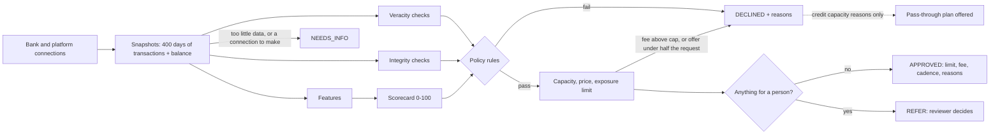

# Cash flow underwriting

CashFlow decides whether to front a business's rent by reading its bank account, not its
credit score. The engine lives in `src/underwriting/` and is pure TypeScript: given a year
of transactions and a current balance it produces a score, a grade, a limit, a fee, and a
list of reasons an applicant can read. No network, no model weights, no hidden state.

This document explains the mechanics so they can be reviewed, argued with, and changed: the
features, the curves, the checks, and the evidence behind each number. The policy those
mechanics implement (eligibility, the escalation matrix, reviewer authority, servicing,
provisioning, and change control) is stated on its own in [`CREDIT_POLICY.md`](CREDIT_POLICY.md).
How the data is obtained is in [`DATA_CONNECTIONS.md`](DATA_CONNECTIONS.md), and the open legal
questions are in [`COMPLIANCE.md`](../../COMPLIANCE.md). Nothing here is legal advice.

## Why cash flow and not credit

Small businesses are thin files. Many have no business credit history, the owner's
personal score says little about the shop's ability to pay rent, and collateral is rarely
available. What every operating business does have is a bank account that shows exactly
how much comes in, how much goes out, when, and how close to the edge it runs. Rent is a
monthly obligation, so the question underwriting must answer is narrow: after everything
else this business pays, is there reliably enough cash on the right days to repay a month's
rent plus a small fee?

## Policy versions

Every number the engine uses lives on a `CreditPolicy` object in `src/underwriting/policy.ts`:
cutoffs, scorecard weights, grade floors, pricing, integrity thresholds, exposure caps, and the
triggers that send an application to a reviewer. `decide(input, policy)` takes the policy as an
argument and defaults to `CURRENT_POLICY`.

| Version       | Status  | What it is                                                                                                |
| ------------- | ------- | --------------------------------------------------------------------------------------------------------- |
| `cashflow-v1` | Retired | The launch policy. Kept as `POLICY_V1` so the portfolio evals can run it beside the current one.          |
| `cashflow-v2` | Retired | Integrity checks, earlier decline detection, expected loss pricing, exposure rules, and manual referrals. |
| `cashflow-v3` | Retired | Version 2 plus the data veracity checks (`src/veracity/`) and a data depth factor that reads them.        |
| `cashflow-v4` | Retired | Version 3 plus the payment history factor and graduation from the free pass-through plan.                 |
| `cashflow-v5` | Current | Version 4 with graduates of the pass-through plan priced on their own PD (see "Graduation").              |

Phases named below are rounds of the project's evaluation work: Phase R1 first measured
version 1 in the portfolio simulation, R2 produced version 2, and R3 changed the simulator to
model the product as built (a whole lease or nothing, a balance check before each debit).

Every stored decision carries the `policyVersion` that made it and a `snapshot`: a summary of
the inputs, the thresholds in force, the integrity flags, the fee build up with PD and
expected loss, the caps on the limit, and the referral triggers. The snapshot is internal. The
applicant facing serializers never include it, and PD tables, weights, and cutoffs are not
exposed through the public API.

Decisions are append-only. An application can have several: the first answer, a resubmission
after more information, a reviewer's outcome, and monthly periodic reviews once a plan runs.
Nothing is deleted. A new decision sets `supersededAt` on the one before it, a partial unique
index allows only one current decision per application, and every reader goes through
`CURRENT_DECISION` in `src/services/decisions.ts`.

Changing a policy number is a policy change: give the policy a new version, rerun
`pnpm --filter @cashflow/api eval:portfolio --strict`, and ship only if every gate passes. The
procedure is in [`CREDIT_POLICY.md`](CREDIT_POLICY.md), "Change control"; the measured effect of
each version, side by side on the same applicants, is in [`evals/report.md`](evals/report.md).

## Pipeline

1. **Bank data, through snapshots.** `services/connections.ts` (`gatherDecisionData`) reads
   400 days of transactions and the current balance from the newest snapshot of the bank
   connection, pulling again first when that snapshot is older than the freshness rule allows:
   a little over a year, so the last four weeks can be compared with the same weeks a year
   earlier. Platform sales and payouts come the same way. See `DATA_CONNECTIONS.md`. Categories are normalized to the
   `TransactionCategory` enum in `packages/shared` so the engine does not care which bank
   data vendor produced them.
2. **Lookups.** The service also gathers what the pure rules cannot see: what the business
   already has with us, what its industry and the pool hold (`services/portfolio-state.ts`),
   and whether the same bank account, landlord account, or business identity appears under
   another user.
3. **Features** (`features.ts`). Transactions are bucketed into full calendar months and
   daily balances are reconstructed backward from the current balance. Credits the integrity
   checks matched to a same sized transfer out are left out of revenue.
4. **Integrity checks** (`integrity.ts`). Can the numbers be trusted. See below.
   4a. **Veracity checks** (`src/veracity/`). Is the data the business's own, complete, and
   unaltered, and how was it obtained. See "Veracity".
5. **Scorecard** (`scorecard.ts`). Eight factors, weights summing to 100, piecewise linear
   curves. Every factor emits a human readable reason tagged positive, negative, or
   informational. Version 4 adds a ninth, payment history, outside the weights: it adds or
   takes points and is absent without history. See "Payment history".
6. **Policy rules** (`engine.ts`). Hard rules that decline regardless of score.
7. **Capacity, price, and limit**, solved together (`pricing.ts`, `exposure.ts`).
8. **Escalation.** Anything a person should look at becomes a `REFER`. Clean applications are
   decided in the same request.
9. **Reasons and notices.** At most four principal reasons are chosen from the reason catalog,
   and a decline's adverse action notice is stored in the same transaction as the decision. See
   "Reasons and adverse action notices".

## Features

All money is integer cents and all ratios are basis points, so a stored decision is exact
and reproducible.

| Feature                       | Definition                                                                                                                                                                                      |
| ----------------------------- | ----------------------------------------------------------------------------------------------------------------------------------------------------------------------------------------------- |
| Verified monthly revenue      | Mean of operating inflows over the last three full months. Card settlements, cash deposits, invoice payments, and other income, net of refunds. Transfers in and loan proceeds are excluded.    |
| Revenue growth                | Last three months versus the prior three. Requires six months.                                                                                                                                  |
| Revenue trend                 | On daily windows of whole weeks: trailing 4 weeks against the 12 before, trailing 12 against the 12 before, trailing 4 against the same 4 a year earlier, and the slope of the last six months. |
| Revenue volatility            | Coefficient of variation of monthly revenue.                                                                                                                                                    |
| Deposit days per month        | Distinct days with an operating inflow. A proxy for how continuously the business sells.                                                                                                        |
| Operating outflows and margin | Payroll, rent, suppliers, utilities, insurance, tax, software, fees. Margin is revenue minus operating outflows over revenue.                                                                   |
| Net cash flow                 | Revenue minus operating outflows, debt service, and owner draws.                                                                                                                                |
| Debt service                  | Loan and merchant cash advance payments per month, and as a share of revenue.                                                                                                                   |
| Observed rent                 | The recurring rent debit already in the account. Once CashFlow pays the landlord this cash is freed up, so it counts toward repayment capacity.                                                 |
| Days of cash on hand          | Current balance divided by average daily outflows over 90 days.                                                                                                                                 |
| Low point of the buffer       | The lowest balance of the last 90 days, in days of average outflows.                                                                                                                            |
| Conduct                       | NSF fees and negative balance days in the last 90 days, plus NSF fees over the year.                                                                                                            |
| Rent to revenue               | Requested rent over verified revenue. The payment to income ratio of this product.                                                                                                              |
| Coverage                      | Free cash (net cash flow plus observed rent) over rent plus fee, times 100. Scored without the fee, stored at the fee quoted. See "Coverage and the fee".                                       |
| Stated variance               | How far the applicant's stated revenue sits above what the bank shows.                                                                                                                          |

## Scorecard

| Factor             | v1 weight | v2 to v4 weight | Full marks                                         | Zero                                    |
| ------------------ | --------: | --------------: | -------------------------------------------------- | --------------------------------------- |
| Rent affordability |        20 |              10 | Rent at or under 10% of verified revenue           | 35% or more                             |
| Cash flow coverage |        20 |              15 | Free cash covers the rent 2.0x                     | Under 1.0x                              |
| Cash buffer        |        15 |              30 | 60 or more days on hand, never under 30 in 90 days | Under 7 days, and a low point of zero   |
| Account conduct    |        15 |              15 | No NSF fees or negative days                       | 6 points per NSF, 1.5 per negative day  |
| Revenue stability  |        10 |              10 | Month to month variation at or under 15%           | 60% or more                             |
| Revenue trend      |        10 |              10 | Up 10% or more                                     | Down 30% or more                        |
| Existing debt      |         5 |               5 | Debt service at or under 3% of revenue             | 20% or more                             |
| Data depth         |         5 |               5 | 12 months of bank history, and a second source     | 3 months or fewer, and no second source |

The curves are drawn for the version 1 weights; under a later policy each factor is scaled to
its weight (`CURVE_MAX` in `scorecard.ts`). Data depth gives up to 4 points for bank history and
1 for a point of sale with at least 3 months of sales. From version 3 the history points are scaled
by the bank connection's trust tier and the point of sale point needs a platform that reconciles
with the bank (see "Trust tiers and how sources are used"). Payment history (version 4) is
outside the 100 points.

Grades: A at 80 or above, B at 68, C at 55, D at 45, F below 45.

What version 2 changed in the scorecard, and why:

- **Weight moved from rent share to the cash buffer.** Under the standard servicing policy a
  default is a liquidity event: a debit fails on the day the balance is short. In the
  simulation, bad rate among funded plans fell from 21% under 7 days of cash to 3% at 60 or
  more, while it was flat across rent share (5.4% to 5.7% from under 8% of revenue to over
  20%), because rent share is already bounded by the hard cap and by capacity.
- **The buffer factor blends in the low point of the last 90 days** (40% of the factor). A
  balance that is healthy today but touched zero last month is thin.
- **Conduct also counts overdraft fees earlier in the year**, one point each.
- **The trend factor reads the season adjusted trend**: the trailing four weeks against the
  same weeks a year earlier when the history allows, otherwise the trailing twelve weeks
  against the twelve before.

These weights were chosen by looking at which factors separated good plans from bad in the
synthetic population. They are judgment informed by a simulation, not coefficients fitted to
real repayment, and they need refitting on real outcomes. A logistic regression on thirty
features fitted to the same simulation ranked the funded book only about 0.02 of AUC better,
which was not worth fitting a scorecard to synthetic data.

### Coverage and the fee

Version 1 scored every applicant's coverage at a flat 2.5% fee, whatever fee they were later
quoted. From version 2 the scored ratio is free cash over rent alone. The fee is set from the
score, so a score that depends on the fee is circular, and scoring it in two passes does not
settle: a second pass can move the score into another band, which changes the fee again. The
fee is at most 4% of rent, so leaving it out moves coverage by at most 4%. The fee is applied
exactly where it binds: capacity leaves room for rent plus the fee actually quoted, and the
coverage ratio stored on the decision is restated at that fee.

## Integrity checks

The scorecard asks whether a business can afford the rent. The integrity checks ask whether
the numbers in front of the scorecard can be trusted. Each is a pure function in
`integrity.ts` returning at most one flag, and what a flag does is fixed in one table,
`INTEGRITY_RULES`:

| Flag                                | Fires when                                                                                            | Action     |
| ----------------------------------- | ----------------------------------------------------------------------------------------------------- | ---------- |
| `STATED_REVENUE_FAR_ABOVE_VERIFIED` | Stated revenue more than 50% above verified                                                           | Needs info |
| `STATED_REVENUE_ABOVE_VERIFIED`     | More than 25% above                                                                                   | Inform     |
| `STATED_REVENUE_BELOW_VERIFIED`     | More than 40% below                                                                                   | Inform     |
| `POS_DEPOSIT_SHORTFALL`             | Bank deposits under 70% of point of sale net sales                                                    | Inform     |
| `POS_DEPOSIT_EXCESS`                | Bank deposits over 150% of point of sale net sales                                                    | Refer      |
| `ROUND_TRIP_DEPOSITS`               | 3 or more credits each matched by a transfer out of the same size within 4 days, 10% or more of sales | Knockout   |
| `ROUND_TRIP_SUSPECTED`              | 2 or more such matches, 3% or more of sales                                                           | Refer      |
| `NON_SALES_CREDIT_SHARE`            | Transfers in and loan proceeds over 30% of all credits in 90 days                                     | Refer      |
| `OWNER_TOP_UPS_BEFORE_APPLYING`     | Transfers in over 10% of monthly revenue in the last 30 days, concentrated there                      | Inform     |
| `REVENUE_SPIKE`                     | Last six weeks more than 75% above the twenty before, and last year does not explain it               | Refer      |
| `SHORT_ACCOUNT_HISTORY`             | Account history more than 3 months shorter than time in business (capped at a year)                   | Refer      |
| `RENT_ABOVE_OBSERVED`               | Requested rent more than 1.2 times the rent seen in the account                                       | Cap        |
| `NO_RENT_OBSERVED`                  | No rent payments in the account                                                                       | Refer      |
| `LANDLORD_IS_APPLICANT_ACCOUNT`     | A lease's landlord payout account is one of the business's own linked accounts                        | Knockout   |
| `DUPLICATE_LANDLORD_ACCOUNT`        | Another user's business pays the same landlord account                                                | Inform     |
| `DUPLICATE_BANK_ACCOUNT`            | Another user's business linked the same bank account                                                  | Refer      |
| `DUPLICATE_BUSINESS_IDENTITY`       | Another user has a business with the same legal name and address                                      | Refer      |
| `IDENTITY_VERIFICATION_FAILED`      | The identity provider could not find the business or one of its owners                                | Knockout   |
| `IDENTITY_NOT_VERIFIED`             | Verification needs review, or has not run (no tax id, no owner, a business that predates it)          | Refer      |
| `SCREENING_POSSIBLE_MATCH`          | The business, an owner, or a landlord has an open possible sanctions or watchlist match               | Refer      |
| `SCREENING_MATCH`                   | The same, with a match                                                                                | Refer      |

- **Knockout** declines, with a reason the applicant can read.
- **Needs info** asks the applicant for something specific.
- **Refer** sends the application to a reviewer.
- **Cap** holds the limit down (see exposure rules) and does nothing else.
- **Inform** is recorded on the decision for reviewers and monitoring and does not change the
  outcome.

The rule of thumb: decline automatically only on a pattern with no innocent reading. A wrong
automatic decline for suspected fraud is the most expensive mistake to make to an honest
applicant, so anything a legitimate business could show goes to a person or only limits the
amount.

Credits matched as round trips are left out of revenue whether or not the pattern is strong
enough to flag, so padded deposits cannot buy a larger limit.

The duplicate and landlord flags need the database. The service looks the facts up and passes
them to the engine as `integrityContext`. The landlord check also runs when a plan is opened,
because the lease is usually linked after the decision.

The identity and screening flags come the same way. On every submission the service runs the
business and its owners through the `IdentityProvider` again, stores the result, and hands the
engine the stored verification status and the worst open screening hit
(`integrityContext.identity`). The engine never calls the provider. A business that is not
`VERIFIED` is never approved automatically. A failed verification declines, with a reason the
applicant can act on. A screening match does not decline: it is held in review, cannot be
approved while the hit is open, and only an admin can clear it. Declining on it would put what
was found into the decline reason. The applicant is told the application is in review and
nothing else.

Flags, their details, and the referral triggers are internal. They appear in the decision
snapshot and the operator review queue, never in what the applicant sees.

## Veracity

The integrity checks ask whether the numbers are plausible. The veracity checks ask whether
the data is the business's own, complete, unaltered, and obtained in a way we can trust. They
are pure functions in `src/veracity/`, each with unit tests for when it fires and when it does
not, and they run inside `decide()` on facts the service gathers (`EngineInput.veracity`): each
connection's platform-reported identity, its current snapshot, and earlier snapshots. Policy
version 3 turns them on (`CreditPolicy.veracity`); versions 1 and 2 ignore the facts, so the
evals can run all three on the same applicants. How the data is obtained, and why there is no
upload path and no credentialed bank login, is in [`DATA_CONNECTIONS.md`](DATA_CONNECTIONS.md).

### Trust tiers and how sources are used

Each source gets a tier from its access method (direct OAuth HIGH, delegated seat MEDIUM,
aggregator HIGH when the bank authorized it through OAuth and MEDIUM for a legacy connection),
lowered to LOW when a finding refers, knocks out, or excludes it, and NONE when it could not be
pulled. The applicant never picks it.

- **Verified revenue** uses platform sales only when the platform's assessment allows it
  (`usableForRevenue`). An excluded platform's features are still computed and stored, but
  revenue, trend and stability come from the bank. The old coarse `depositMatchBps` stays
  populated for compatibility; settlement reconciliation is now the primary signal.
- **Data depth** (scorecard 3): the bank history credit (up to 4 of the factor's 5 points) is
  multiplied by the bank's tier (HIGH 1, MEDIUM 0.75, LOW 0.5), and the second source point is
  given only to a platform that is independently verified: usable, at least 8 payouts in the
  window, at least 85% of them by amount found among deposits, and an account older than 6
  months. Without veracity facts, scorecard 3 scores exactly as scorecard 2.
- **The decision snapshot** stores the whole assessment: findings with evidence, per source
  tiers, the reconciliation, and the ids and hashes of the snapshots read.
- **The owner** sees reasons in plain words that name the next step and never a rule; an
  operator sees every finding and its evidence (ops console, review and customer pages).
- **Re-underwriting and the refresh job** go through the same path. In a periodic review an
  ask (connect the payout account) is shown to the owner but does not stop the plan being
  scored, except a bank that cannot be pulled.

### Findings and what they do

One table, `VERACITY_RULES` in `src/veracity/rules.ts`. The measured columns are from the
default evaluation (5 seeds of 2,000, `evals/report.md`, "Data veracity"): the share of honest
applicants on whom the finding fired, and the share of the fraud archetype it exists for on
which it fired. "Exclude" means the source also stops counting toward revenue.

| Finding                            | Check              | Consequence         | Honest fired | Fraud it targets: fired |
| ---------------------------------- | ------------------ | ------------------- | -----------: | ----------------------- |
| `BOTH_SOURCES_OTHER_BUSINESS`      | Ownership          | Knockout, exclude   |        0.00% | borrowed account 57%    |
| `BANK_OWNER_MISMATCH`              | Ownership          | Refer               |        0.71% | borrowed account 100%   |
| `PLATFORM_NAME_MISMATCH`           | Ownership          | Refer, exclude      |        0.62% | borrowed account 57%    |
| `PLATFORM_TAX_ID_MISMATCH`         | Ownership          | Refer, exclude      |        0.47% | (none modeled)          |
| `PERSONAL_ACCOUNT`                 | Ownership          | Inform              |        7.22% |                         |
| `PAYOUT_ACCOUNT_NOT_CONNECTED`     | Payout destination | Needs info, exclude |        0.85% |                         |
| `PAYOUTS_PARTLY_TO_UNSEEN_ACCOUNT` | Payout destination | Needs info, exclude |        0.00% | unsettled sales 50%     |
| `SETTLEMENT_UNMATCHED`             | Settlement         | Refer, exclude      |        0.13% |                         |
| `SETTLEMENT_LOW_MATCH`             | Settlement         | Exclude source      |        0.02% |                         |
| `DEPOSITS_WITHOUT_PAYOUT`          | Settlement         | Refer, exclude      |        0.00% | (unit tested)           |
| `SALES_NOT_PAID_OUT`               | Completeness       | Refer, exclude      |        0.00% | unsettled sales 50%     |
| `POS_REVENUE_NOT_IN_BANK`          | Completeness       | Exclude source      |  not reached | (no payouts data)       |
| `TRANSFERS_TO_UNSEEN_ACCOUNTS`     | Completeness       | Needs info          |        1.21% | hidden accounts 91%     |
| `UNSHARED_ACCOUNTS`                | Completeness       | Inform              |       24.75% |                         |
| `TRANSFERS_FROM_UNSEEN_ACCOUNTS`   | Completeness       | Inform              |        1.57% |                         |
| `HISTORY_REWRITTEN`                | Consistency        | Knockout, exclude   |        0.00% | rewritten history 100%  |
| `HISTORY_CHANGED`                  | Consistency        | Refer               |        0.35% |                         |
| `SALES_HISTORY_CHANGED`            | Consistency        | Refer, exclude      |  not reached | (unit tested)           |
| `HISTORY_MINOR_CHANGES`            | Consistency        | Inform              |        0.86% |                         |
| `PLATFORM_NEW_WITH_SURGE`          | Account age        | Refer, exclude      |        0.35% | fresh POS account 80%   |
| `PLATFORM_ACCOUNT_RECENT`          | Account age        | Reduce depth        |        6.26% |                         |
| `BANK_ACCOUNT_RECENT`              | Account age        | Inform              |        0.30% |                         |
| `DATA_GAP`                         | Account age        | Inform              |        0.00% |                         |
| `BANK_DATA_UNAVAILABLE`            | Freshness          | Needs info          |        0.53% |                         |
| `PLATFORM_DATA_UNAVAILABLE`        | Freshness          | Exclude source      |        0.96% |                         |
| `LEGACY_BANK_CONNECTION`           | Method             | Reduce depth        |       18.92% |                         |
| `DELEGATED_SEAT_SOURCE`            | Method             | Inform              |        6.15% |                         |

Why each consequence:

- **Knockout only where there is no innocent reading and a person could not fix it.**
  `HISTORY_REWRITTEN`: posted debits vanishing from a closed period with nothing added. Late
  posting inside the last 7 days of the earlier pull is forgiven; id and description changes
  are ignored; duplicates are additions and go to `HISTORY_CHANGED`. The first run also knocked
  out flattering additions, and two honest applicants whose aggregator duplicated old credits
  were declined: that is why additions now refer. `BOTH_SOURCES_OTHER_BUSINESS`: the bank and
  the platform, independently, name the same kind of thing (another business) as the holder.
  Measured honest knockouts: 0 of 9,541.
- **Needs info where the owner can settle it by connecting an account.** Payouts to an account
  that is not connected, and sustained transfers to one, are both a missing connection: the
  owner connects it, or the application waits. The first run referred `TRANSFERS_TO_UNSEEN_ACCOUNTS`
  and `PAYOUTS_PARTLY_TO_UNSEEN_ACCOUNT`; review (which catches 70% of referred fraud by
  assumption) let 2 of 9 hidden account and 1 of 5 unsettled sales applicants through on seed
  1, and the fraud gate rose to 6.5% on that seed. Asking for the account is also what a
  reviewer would do. The cost: honest businesses that sweep profit to savings are asked to
  connect it (1.21% of honest applicants), and the evals treat an ask as terminal.
- **Refer where an honest business can show it and a person can verify it.** A holder that is
  a spouse or a holding company, a former company name on the platform, a tax id typo,
  payouts that do not arrive, deposits that claim a platform with no record of them, a new
  platform account arriving with a jump in revenue. Referral costs time, not the approval, for
  an honest applicant (the evals assume a reviewer approves them), and it is bounded by the
  refer ceiling and the new `veracity_honest_adverse` gate.
- **Exclude the source when only that source is in doubt.** Weak reconciliation, a platform
  that could not be pulled, or sales at the platform that do not reach the bank: decide on the
  bank alone, which is what version 2 did for every applicant without a platform.
- **Reduce depth for method strength.** A legacy bank connection and a young platform account
  are weaker evidence, not bad evidence.
- **Cap: nothing.** In a whole-lease product a capped limit is a counter offer that cannot open
  a plan, so a cap is a decline in disguise. The mechanism exists (`CAP` holds the limit to 75%
  of the request) and no finding uses it.
- **Missing or failed connections are never a decline.** A bank that cannot be pulled is a
  request to reconnect; a platform is dropped from the decision.

### Thresholds

All on `VERACITY_POLICY_V3` in `src/underwriting/policy.ts`.

| Threshold                    | Value                                              | Why                                                                                                                                                                                                                                                                                                           |
| ---------------------------- | -------------------------------------------------- | ------------------------------------------------------------------------------------------------------------------------------------------------------------------------------------------------------------------------------------------------------------------------------------------------------------- |
| Name match                   | Dice 0.80 on normalized tokens                     | Suffixes, punctuation, case, "and"/"&", dba aliases and one-letter typos removed first. 0.80 accepts one extra word on a three word name ("Blue Door Bakery Cafe", 0.86) and rejects a changed word ("Blue Door Coffee", 0.67). People: same surname, and first name equal, an initial, or a common nickname. |
| Reconciliation window        | 90 days, last 5 in transit                         | A quarter of payouts is enough to measure; payouts of the last few days may not have landed.                                                                                                                                                                                                                  |
| Date tolerance               | 1 day before, 4 after                              | A processor can date a payout the day before it posts; weekends, holidays and holds push a deposit up to four days later.                                                                                                                                                                                     |
| Amount tolerance             | larger of 0.5% and $1                              | Payout amounts are already net of fees, refunds and chargebacks, so they should match to the cent; this absorbs rounding and small bank adjustments.                                                                                                                                                          |
| Combinations                 | up to 4                                            | Two or three locations paid separately, a bank that splits a transfer, a batch of daily payouts.                                                                                                                                                                                                              |
| Minimum payouts              | 8                                                  | Fewer is not a rate.                                                                                                                                                                                                                                                                                          |
| Use platform revenue         | 85% matched by amount                              | The old coarse check accepted 70% of monthly sales in deposits; matching payout by payout is precise, so the bar is higher.                                                                                                                                                                                   |
| Refer                        | under 50% matched                                  | Most of what the platform says it paid into a connected account is not there.                                                                                                                                                                                                                                 |
| Sales not paid out           | payouts under 75% of card net sales                | Payouts should be card sales less fees (about 97%); reserves and holds explain a few points, not a quarter.                                                                                                                                                                                                   |
| Unseen payouts               | 15% of payouts                                     | Above rounding and a stray refund to another card.                                                                                                                                                                                                                                                            |
| Deposits without a payout    | 3 or more, and 20% of deposits naming the platform | One or two can be a reversal or a correction.                                                                                                                                                                                                                                                                 |
| Transfers to unseen accounts | 10% of 90 day revenue, in each of 3 months         | Sustained and material: the size of a loan or an advance, above a modest savings habit.                                                                                                                                                                                                                       |
| Consistency tolerance        | last 7 days of the earlier pull forgiven           | Pending items post late, tips settle, a pending item drops: inside a week.                                                                                                                                                                                                                                    |
| Material change              | 3 or more items, or 1% of volume                   | One or two corrected items are a bank correction.                                                                                                                                                                                                                                                             |
| Recent account               | under 6 months                                     | Two quarters of history.                                                                                                                                                                                                                                                                                      |
| Established business         | 24 months (bank), 12 (platform)                    | A two year old business with a three month old bank account is worth recording; a platform switch is common, so a lower bar applies there.                                                                                                                                                                    |
| Surge                        | revenue 40% above the same span before             | Well above seasonal and growth movement over a few months.                                                                                                                                                                                                                                                    |
| Data gap                     | 14 days                                            | Two weeks without a transaction in an operating account.                                                                                                                                                                                                                                                      |
| Freshness                    | snapshot within 1 day, newest item within 7        | A decision reads today's data; the 7 days are the periodic review's existing rule.                                                                                                                                                                                                                            |

These were chosen before the evaluation and not tuned on it. Two consequences and one
condition were changed after the first run, with the reasons above; no threshold was.

### The PD table

Not regenerated. Version 3 changes the score only through the data depth factor (at most one
point down for a legacy bank connection, and the second source point now needs a reconciled
platform), and through which revenue figure is used when a platform is excluded. On the
default run the honest applicants' through the door AUC is 0.873 against 0.873 for version 2
on the same applicants, and the bad rate by grade is monotonic. Regenerating would change fees
for every applicant for an effect inside the table's own noise; it is left for the next
calibration.

## Payment history

Version 4 reads how a business has paid rent through CashFlow, on either kind of plan, and
scores it. A first time applicant has no history and is scored exactly as under version 3:
the factor is absent, not zero, the score and every reason are the same, and the evals
check that origination decisions are identical (`v3_standard` against `v4_standard`).

### The record

`src/services/payment-history.ts` builds it on every read; `src/underwriting/payment-history.ts`
classifies and summarizes it, purely. One month per rent period:

| Outcome   | Financed plan                                                                                  | Pass-through plan                                      |
| --------- | ---------------------------------------------------------------------------------------------- | ------------------------------------------------------ |
| `ON_TIME` | Every installment collected inside grace (3 days), and no payment on the period ever came back | Collected, settled, and paid to the landlord           |
| `LATE`    | Everything paid in the end, but after grace or after a returned debit                          | (none)                                                 |
| `MISSED`  | Charged off, or an installment 30 days past due                                                | Nothing collected in time, or the collection came back |

A month still in progress has no outcome. Nor does a month in which nothing was owed: a
financed payout that was never made, a pass-through month refunded because its landlord
payout was held too long, or one cancelled before collection.

**Why a derived view and not a table.** Every fact it reads is already stored for another
reason and written in the same transaction as the ledger posting it records: landlord
payouts, installments and their repayments (a returned debit is a repayment marked
`RETURNED`), and the status of each pass-through month, which only the collection,
settlement, payout and return services set. A table of outcomes would be a second copy of
those facts that could drift from them, and something would have to keep it in step when a
return arrives weeks later. The view cannot drift: a returned payment stops counting as on
time the moment it is reconciled, and nobody can enter a month by hand. The cost is a few
queries per read over at most a few dozen rows a business. `GET /v1/businesses/:id/payment-history`
returns it, and so does the ops console's customer page.

### The factor

On `PAYMENT_HISTORY_POLICY_V4` in `src/underwriting/policy.ts`:

| Setting                  | Value | Why                                                                                                             |
| ------------------------ | ----: | --------------------------------------------------------------------------------------------------------------- |
| Lookback                 |    12 | A year: an old miss stops weighing on a business that has paid since.                                           |
| Points per on time month |     2 | Counted on the current run of on time months, not the total, so a recent miss resets it.                        |
| Most points from the run |     8 | Four months. Less than one grade step: history moves a borderline business, it does not make a weak one strong. |
| Points per late month    |     4 |                                                                                                                 |
| Points per missed month  |    10 | A miss on rent we were paying is the strongest signal there is.                                                 |
| Most points taken        |    20 |                                                                                                                 |

The factor appears in the reasons the owner reads (`PAYMENT_HISTORY`) and is stored on the
decision snapshot with the summary it read and the score before it (`snapshot.paymentHistory`).

**It never adds a referral.** The score band referral (a score fewer than 5 points above the
cutoff) reads the score before payment history (`Scorecard.baseScore`). Payment history can
move a business across the cutoff, but cannot put an application into the reviewer's queue
that would not have gone there without it, nor take one out. Measured in the evals: the
refer rate is the same as version 3's to the applicant.

The PD table is not regenerated for version 4. Every first time decision is version 3's, and
those are what the table is calibrated on. The graduated cohort is too small to calibrate a
band on (see "Graduation" and `evals/report.md`).

## Policy rules

Applied after scoring. Any one of these declines the application, and the scorecard
reasons are still returned so the applicant sees the full picture.

- Fewer than 6 months in business (self reported).
- Verified revenue under $5,000 a month.
- More than 2 NSF fees in the last 90 days.
- More than 10 negative balance days in the last 90 days.
- Requested rent above 40% of verified revenue.
- Revenue down more than 25% quarter over quarter.
- Earlier decline detection (version 2, below).
- No positive free cash flow after expenses, owner draws, and existing debt.
- Score below 50 (45 under version 1).
- An integrity knockout.

Missing information is never a decline. These return NEEDS_INFO with a specific ask:

- No bank account connected.
- Fewer than 6 full months of transactions in the connected account.
- Stated revenue more than 50% above verified revenue. The applicant is asked to connect
  other accounts that receive revenue or correct the figure.

### The cutoff, and grade D

The minimum score is the lowest five point band that kept a positive net margin under mild
stress in two independent 10,000 applicant runs under the standard servicing policy:

| Score band | Bad rate, base | Bad rate, mild stress | Net margin, mild stress | Customers profitable, mild |
| ---------- | -------------: | --------------------: | ----------------------: | -------------------------: |
| 45 to 49   |     29% to 35% |            52% to 58% |           -18 to 12 bps |                 46% to 48% |
| 50 to 54   |     20% to 24% |            37% to 39% |            65 to 76 bps |                 64% to 65% |
| 55 to 59   |     17% to 19% |            24% to 29% |            80 to 98 bps |                 71% to 76% |

So the cutoff is 50. The lower half of grade D is declined. The upper half (50 to 54) is
approvable, but never automatically: a score fewer than 5 points above the cutoff is referred
to a reviewer. That band is where the model is least sure and a third of its customers go
delinquent in a mild downturn.

### Earlier decline detection

The quarter over quarter rule declines only when the last three full months are more than 25%
below the prior three. By the time a slide shows that clearly in calendar quarters it is
months old: Phase R1 found 27 of 73 businesses in early decline approved, and 70% of those
went bad. Version 2 adds `detectDecline`, which reads windows ending on the application date
and uses the same weeks a year earlier to tell a seasonal trough from a decline:

- **With a year of history.** Decline when the trailing four weeks are down more than 15% on
  the same weeks a year ago, and the trailing twelve weeks are down at least 5% on the twelve
  before. The 15% widens to 1.5 times the business's own month to month variation when that
  is larger, so a noisy business is not declined for one odd month. A seasonal business in
  its slow season is level with last year and passes.
- **Without a year of history** there is no way to rule out a season, so the bar is higher:
  the trailing twelve weeks down more than 20% on the twelve before.
- **With a thin buffer** (under 14 days of cash) a 10% decline is enough.

## Capacity, pricing, and the limit

These three depend on each other and are solved together: servicing is a fixed cost, so the
fee rate rises as the rent falls, and a higher fee leaves less room under the coverage test.
The engine starts at the requested rent and steps down until the three agree.

### Capacity

The largest monthly rent that satisfies both of these, rounded down to $100:

- **Revenue share.** Rent may be at most a share of verified revenue that depends on grade:
  A 30%, B 25%, C 20%, D 15%.
- **Coverage.** Free cash must cover rent plus the quoted fee at least 1.25 times.

### Pricing on expected loss

`pricing.ts`. The fee has to pay for four things, each in basis points of rent per period:

| Part          | How it is set                                                                                            |
| ------------- | -------------------------------------------------------------------------------------------------------- |
| Expected loss | PD for the score band, times loss given default, spread over the periods a plan is expected to be funded |
| Cost of funds | 12% a year on the rent while it is out: 24 bps with two installments, 35 bps with four                   |
| Servicing     | $12 a plan a month, so it is a larger share of a small rent                                              |
| Margin        | 40 bps                                                                                                   |

`fee = max(grade floor, the sum above, the minimum fee)`, rounded up to 5 bps.

- **Grade floors**: A 1.5%, B 2.0%, C 2.5%, D 3.0% of rent per period.
- **Minimum fee: $20 a period**, whatever the rent. Phase R1 found about 50 good customers at
  a median rent near $700 who lost money because a 1.5% fee ($10.50) does not cover $12 of
  servicing.
- **Maximum fee: 4% of rent.** When the fee needed is above the cap the application is
  declined with that reason (`FEE_ABOVE_MAXIMUM`, or `RENT_BELOW_MINIMUM` when the fixed cost
  is what pushes it over). The engine never approves at a capped fee that does not cover the
  risk. With a $20 minimum and a 4% cap, the smallest rent that can be served is $500.

The PD table (`pd-table.ts`) is generated, not written by hand:
`pnpm --filter @cashflow/api eval:calibrate` runs the current policy under the standard
servicing policy on 20,000 synthetic applicants (seeds that the gates are not judged on),
measures the share of funded plans in each five point score band that went bad, pools bands
where needed so PD never rises with score, and writes the table with the run parameters. PD
runs from about 21% in the lowest funded band to under 2% in the highest. Loss given default
is measured in the same run: 60% of one month's rent, because under the standard servicing
policy a plan is never more than one period ahead of its repayments.

At these loss levels the build up is below the grade floor for most applicants. On the
version 2 evaluation run the floor set the fee for 83% of funded plans, the build up for 13%
(smaller rents, where $12 of servicing is a larger share), and the minimum fee for 5%.
The PD, the expected loss, and the whole build up are stored on the decision snapshot.

When a plan is opened on a lease smaller than the approved limit, the rate is raised if
needed so the fee is still at least the minimum in cents, and a lease too small to serve
inside the cap is refused.

### Exposure rules

`exposure.ts`, pure functions. The approved limit is the smallest of:

| Cap                | Rule                                                                                           |
| ------------------ | ---------------------------------------------------------------------------------------------- |
| The request        | An approval is for the lease in front of us. Version 1 could approve more than was asked.      |
| Capacity           | Above.                                                                                         |
| Observed rent      | At most 1.2 times the rent seen in the bank account, unless a reviewer has verified the lease. |
| The ladder         | $10,000 a month across all plans at first, $20,000 after 3 on time periods, $40,000 after 6.   |
| Business aggregate | $40,000 a month across all of one business's plans and leases, whatever its history.           |

If the limit is at least half of the requested rent the application is approved at the lower
limit with a `LIMIT_BELOW_REQUEST` reason, which is a counter offer rather than a decline.
Below half it is declined, with a reason that names the cap that bound
(`INSUFFICIENT_CAPACITY`, `RENT_NOT_VERIFIED`, or `EXPOSURE_LIMIT`).

**Why 1.2 times observed rent.** The bust out pattern is a clean account, a lease several
times the rent it shows, and an account emptied days after approval. Phase R1 approved 11 of
12 and all defaulted on the first payment. Their requests ran 2.5 to 4 times observed rent.
At 1.2 times, a request of 2.4 times observed rent or more is offered under half of what it
asked and is declined, which covers that whole range, while a rent step of up to 20% (an
escalator, a modest move) is approved in full. The simulation cannot price the cost of this
rule to honest applicants, because every honest applicant in it asks for the rent it already
pays.

**The ladder** bounds the size of a single loss while there is no repayment history. A
default costs up to one month's rent, and $10,000 is the fee income of well over a hundred
average plan months. It bound on about one approval in twenty in the version 2 evaluation.

Three more rules depend on the pool, not on the business:

| Rule              | Ceiling                                            |
| ----------------- | -------------------------------------------------- |
| Pool utilization  | Committed monthly rent at most 85% of pool capital |
| Industry share    | One industry at most 40% of pool capital           |
| Single name share | One business at most 5% of pool capital            |

These are funding rules. Failing one does not make the business less creditworthy: the
decision is unchanged, the applicant is told the start of the plan may wait
(`FUNDING_QUEUE`), and `createRentPlan` refuses to open the plan until there is room
(`FUNDING_UNAVAILABLE`). Keeping them apart from the credit limit means a small or empty pool
never turns into a decline. "Committed" means monthly rent on active and paused plans. Pool
capital is pool cash from the capital provider, unswept operating cash, and receivables from
the ledger.

`createRentPlan` runs all of this again on the day a plan is opened, because a decision can
be weeks old by then: the limit, the ladder and aggregate cap against the business's other
plans, and the three funding rules. The portfolio simulator applies the same functions to its
own in memory state.

The engine also suggests an installment cadence. Businesses with daily card deposits and a
thin cash buffer, or highly variable revenue, are steered to four smaller installments a
month; everyone else gets the default two.

## Escalation and review

The full escalation matrix, every condition and what it does, and reviewer authority are
stated as policy in [`CREDIT_POLICY.md`](CREDIT_POLICY.md), sections 8 and 9. The mechanics:

An application that would otherwise be approved is referred instead when any of these fires:

- an integrity flag mapped to Refer
- a score fewer than 5 points above the cutoff (50 to 54)
- a limit above $10,000 a month, which only a business past the first rung of the ladder can
  reach
- the circuit breaker is tripped (trigger `CIRCUIT_BREAKER`): a monitoring rule found the book
  outside what the policy was evaluated for, so every new approval gets a person until an
  admin resets it. See "Monitoring" in [`ARCHITECTURE.md`](../../ARCHITECTURE.md)
- a veracity finding whose consequence is Refer (see "Veracity")

Counter offers on a first plan are **not** referred. They are about a third of approvals (1,812
of 5,799 on the default run), so referring them all would put one applicant in five in a
queue. When version 2 was tuned, while the simulator still fronted counter offers in part,
deep counter offers (under 60% of the request) went bad more often: 11% on the tuning seeds and
16% on the gate seeds, against 7.5% for counter offers as a whole. That is the risk of grades C
and D, which the fee already reflects, and a reviewer has nothing to verify on them that the
engine did not see. Referring only those would have added about 2 points to the refer rate. The
switch exists (`referCounterOfferBelowBps`) and is off. Since the product fronts a whole lease
or nothing, a counter offer opens no plan anyway; the applicant gets an adverse action notice
if it is not taken up.

A referral sets the application to `IN_REVIEW` with decision outcome `REFER`. The engine's
recommended limit and fee are stored for the reviewer but are not shown to the applicant
until a review approves. An application the credit rules already decline is not referred.

A reviewer records a decision through `POST /v1/admin/applications/:id/review`: approve,
decline, or request information, with reason codes and notes. The queue is
`GET /v1/admin/reviews`. A reviewer can also reconsider an application the engine declined.
Each review is an `ApplicationReview` row and produces a new current decision of kind
`REVIEW`; the engine's decision stays in the history. A review whose outcome or terms differ
from the engine's recommendation is an **override**: it needs at least one reason code, is
marked on the review and the decision, and writes its own audit event. A reviewer's limit may
not exceed the rent requested, and the fee must be inside the cap. The reviewer is the person
named in the `X-Admin-Actor` header of the authenticated request, never a field in the body.

An approval is refused while the business has an open screening hit (clear it in the screening
queue first), and for a business that is not verified unless the review carries the
`IDENTITY_VERIFIED` reason code, which records that the reviewer verified it another way and
marks the business verified.

## Reasons and adverse action notices

This section is not legal advice. It records how the product reads the rules, the choices
made where a reading was needed, and the questions that need a lawyer. Regulation B (12 CFR
part 1002, implementing the Equal Credit Opportunity Act) is the model throughout.

### The reason catalog

`packages/shared/src/adverse-action/catalog.ts` lists every reason the engine, the integrity
and veracity checks, identity verification and a reviewer can give: 49 entries. Each has a
stable code (stored on decisions and notices, never renamed), a short title, plain applicant
text, guidance on what would change the outcome, whether it may be a principal reason on an
adverse action notice, its kind (decline rule, counter offer, scorecard factor, request for
information, status line), and the rule or factor that produces it (internal, never shown).

- The engine writes the specific text for its own reasons at decision time, with the
  applicant's numbers in it ("20 overdraft fees in the last 90 days. We allow at most 2.").
  The catalog text is the fallback: a reviewer's pick, or a decision stored before the
  catalog.
- Tests hold it to that: `reason-catalog.test.ts` scans the engine, the scorecard and the
  review service for every code they can write and drives the engine across a synthetic
  population with a raised share of fraud (every outcome, 28 distinct codes reached); every
  reason must be in the catalog, and every applicant text must pass `INTERNAL_JARGON`
  (no "cutoff", "knockout", "policy", "bps", "threshold", "insufficient score", internal
  standards, flags, camelCase or SNAKE_CASE identifiers).
- "Score below the minimum" is in the catalog but is never a principal reason: Regulation B
  commentary (comment 9(b)(2)-4 and -5) says the reasons must be the factors actually scored,
  not that a score fell short. The engine's own message for it no longer quotes the score
  or the cutoff.

### Principal reasons

`selectPrincipalReasons` in `packages/shared/src/adverse-action/principal.ts`, pure and
deterministic, picks at most four (comment 9(b)(2)-1: more than four is not likely to be
helpful):

1. On a decline, the rules that declined on their own, in the order the engine applies them
   (trust checks, then credit rules, then capacity and price). Each alone was enough.
2. Then the scorecard factors that lost the most points against their full marks, which is
   what kept the score from the approve threshold. On a decline every factor not helping
   counts; on a counter offer only those hurting. A factor a rule above already restates
   (overdraft fees and account conduct) is not listed twice. Ties go to catalog order.
3. A counter offer leads with `LIMIT_BELOW_REQUEST`, whose text names the cap that bound.
4. A request for information lists what is missing.

The engine stores the factor points on the decision snapshot (internal) and the principal
reasons on the decision (`UnderwritingDecision.principalReasons`). A reviewer's decline or
request for information must pick its reasons from the catalog (`principalReasonCodes`,
codes a reviewer may give for that action); the review service refuses one without them.
The reviewer's internal reason codes (`FRAUD_SUSPECTED`, `OTHER`) stay internal.

### What the applicant sees

`GET /v1/underwriting/applications/:id/explanation` (`DecisionExplanation` in
`packages/shared`): the outcome as the applicant reads it (approved, counter offer,
declined, in review, needs information), the principal reasons with guidance, each
scorecard factor as helping, neutral or hurting with what it measures and what we found,
the rules that ran and whether each was met, the connections read with the date of the data,
and on an approval the limit, fee and why. On a referral, what happens next and the date
the answer is due.

**The score is shown only on an approval or a counter offer.** A decline can come from a
rule while the score is high, and a green "A, Score 97" beside "not approved" told the
applicant the opposite of the decision. On a decline or a referral the applicant sees the
reasons and the factor statuses, never the number. The applicant decision payload carries no
score or grade unless the outcome is an approval. Point values, weights, cutoffs, flags and
referral triggers are never included.

Before submitting, the application form says what data is used (the connected bank and
point of sale, identity checks on the business) and that, if we cannot approve the full
rent, the applicant will be told the specific reasons in writing.

### Notices

`AdverseActionNotice` is append only (a trigger rejects UPDATE and DELETE) and, like
`DataSnapshot`, has no foreign keys, so deleting a business never deletes a notice it was
sent (records are kept under 1002.12(b)). Each row stores the kind, the principal reasons as
rendered, the full text as delivered, the statement version (`cashflow-notice-v2`), the date
the action was taken, the deadline it had to meet, the delivery time and channel (`IN_APP`;
there is no email seam yet), and who generated it. One notice per decision and kind. Since
`cashflow-notice-v2` a notice names the application by a short reference number (the last six
characters of its id, uppercased, `noticeReference` in `packages/shared`), never the raw id;
the app shows the same reference beside the notice.

| Kind                         | When                                                                                        | Deadline                                                       |
| ---------------------------- | ------------------------------------------------------------------------------------------- | -------------------------------------------------------------- |
| `DECLINE`                    | In the transaction that writes a decline, by the engine or a reviewer                       | 30 days after the completed application, 1002.9(a)(1)(i)       |
| `COUNTER_OFFER_NOT_ACCEPTED` | The owner declines the offer (`POST .../decline-offer`), or 30 days pass with no plan on it | 90 days after the counter offer, 1002.9(a)(1)(iv)              |
| `INCOMPLETE`                 | 10 days waiting on information: a notice of incompleteness with a date 30 days out          | 30 days after the application, 1002.9(a)(1)(ii) and (c)(1)-(2) |
| `INCOMPLETE_DECLINED`        | The day after that date, if still incomplete, and only once the first notice was sent       | 30 days after closing it, 1002.9(a)(1)(ii)                     |
| `PLAN_FROZEN`                | In the transaction that freezes a running plan: a periodic review, or an operator hold      | 30 days after the freeze, 1002.9(a)(1)(iii)                    |

A counter offer taken up (a financed plan opened on it) gets no notice: it is not adverse
action. The counter offer window is for the notice only; a plan can still be opened on an
expired offer, as before. The `adverse-action-notices` job (after `provision`, before
`monitor`) stores the date driven notices and any decline that somehow has none, marked late
if past its deadline. Both the job and monitoring read one pure schedule,
`src/adverse-action/schedule.ts`.

Every adverse action notice (`src/adverse-action/render.ts`) carries a statement of the
action, the creditor's name and address (1002.9(a)(2)), the specific principal reasons with
what would change each (1002.9(b)(2)), and the ECOA statement in the words of 1002.9(b)(1)
with the federal agency. The creditor details are placeholders in `CREDITOR`
(`src/adverse-action/policy.ts`), marked `[PLACEHOLDER]` in every notice, because there is
no company behind this repository.

**Business credit, done conservatively.** 1002.9(a)(3) lets a creditor give business
applicants with revenue of $1 million or less the reasons on request, and gives larger
businesses longer and looser rules. CashFlow does not use either option: every adverse
action, whatever the business's revenue, gets the specific reasons in writing, on the
consumer timetable.

### Monitoring

`compliance.adverse_action_notice_missing` (now on; `adverseActionNoticeRuleActive`) alerts
on any notice owed and not stored a day after it fell due, high, and critical past its
deadline. `compliance.adverse_action_notice_late` records a notice delivered after its
deadline, once, and does not resolve itself. `compliance.decision_deadline` already warns on
an application in review at 20 days and goes critical at 30. The append-only trigger on
notices is checked with the others.

### Evals

`evals/report.md`, "Principal reasons on declines and counter offers", reports the
distribution of principal reasons and the share of declines and counter offers with at
least one catalog reason with applicant text. The `adverse_action_reasons` gate requires
100%. The decisions themselves are unchanged by this phase.

### Questions for counsel

Kept here in context. All of them are collected, deduplicated and numbered with the rest of the
repository's open questions in [`COMPLIANCE.md`](../../COMPLIANCE.md), section 14: items 1 and 10
below are its question 10, 2 is 2, 3 is 3, 4 is 4, 5 is 5, 6 is 6, 7 is 7, 8 is 8, and 9 is 9.

1. **Federal agency.** The notice names the Federal Trade Commission, which appendix A to
   Regulation B gives for creditors not otherwise listed. A bank or capital partner, or a
   state licence, could change the agency, or require a second one.
2. **Is a rent advance "credit" under ECOA, and is the pass-through plan?** The financed
   plan defers a debt (1002.2(j)); the free pass-through plan advances nothing and is treated
   here as not credit, so its offer and its end send no notice. Confirm both.
3. **FCRA section 615(a).** The identity provider verifies the business and screens its
   owners. If any part of that is a consumer report on an owner and it contributed to an
   adverse action (an `IDENTITY_NOT_VERIFIED` decline), the notice must add the 615(a)
   disclosures: the agency's name, address and phone, that it did not make the decision, and
   the right to a free copy and to dispute. The notice does not include them today.
4. **In-app delivery.** Notices are delivered in the app only. Whether that is delivery
   under 1002.9 needs E-SIGN consent (15 U.S.C. 7001(c)) or a mailed or emailed copy.
5. **Counter offers.** The notice is sent when the offer is declined or expires after 30
   days, inside the 90 days of 1002.9(a)(1)(iv). Is 30 days a reasonable window, and should
   the counter offer and the adverse action notice instead go out together (also allowed
   there)?
6. **Incomplete applications.** 1002.9(c)(2) ends the obligation when a notice of
   incompleteness goes unanswered; CashFlow sends a closing notice anyway. Confirm that
   this is harmless, and that 10 days then 30 days are reasonable.
7. **Periodic reviews and freezes.** A monthly review that freezes advances on a running
   plan, and an operator's hold, are treated as "an unfavorable change in the terms of an
   account" (1002.2(c)(1)(ii)), and a `PLAN_FROZEN` notice is stored with the freeze. Does the
   delinquency exception (1002.2(c)(2)(ii)) make it unnecessary for a freeze for
   deterioration, is "plan under review" (`PLAN_UNDER_REVIEW`, the reason on an operator
   hold) specific enough, and is the wording of the freeze notice adequate?
8. **Reviewer declines for suspected fraud.** The reviewer must pick a catalog reason, for
   example "We could not verify the revenue on your application". Is that specific enough
   (comment 9(b)(2)-2 allows "unable to verify"), and is it ever acceptable to withhold the
   real reason?
9. **Screening holds.** An application held in review on a watchlist match never gets a
   decline from the engine. If it is declined after review, what may the reason say?
10. **Placeholders.** The creditor name, address and contact must be real before any real
    applicant sees a notice.

## Pass-through plans

A business declined for credit capacity can still have CashFlow pay its landlord, free, on a
pass-through plan (`RentPlan.kind = PASS_THROUGH`): CashFlow collects the whole month's rent
from the business's bank five business days before the due date and pays the landlord on the
due date, once the collection is past its return window. It never advances its own money on
one, so it carries no credit risk, and it never touches the capital pool or the exposure caps.
The money flow and postings are in `ARCHITECTURE.md`, "Pass-through plans".

Who is offered one (`passThroughEligibility` in `src/underwriting/pass-through.ts`): an
engine decision that is `DECLINED` with at least one capacity reason (too new, revenue too
low, overdrafts, negative days, rent share, decline in revenue, no free cash flow, score
below the cutoff, no capacity, fee above the cap, rent below the minimum, exposure limit) and
no trust reason. Never on a referral, a request for information, a reviewer's decision, or a
decline with an integrity or veracity knockout, an identity that could not be verified, a
landlord account that is the applicant's own, or a lease far above the rent the account shows
(`RENT_NOT_VERIFIED`). A pass-through plan moves the business's money to a payee on its say
so: anything that questions who the business is or whether the lease is real rules it out.

The plan's terms as policy are in [`CREDIT_POLICY.md`](CREDIT_POLICY.md), section 10.

**For counsel: is the pass-through plan money transmission?** CashFlow receives the business's
own money and holds it for a few days before paying it on to a third party, the landlord, on the
business's instruction. That is the pattern state money transmitter laws and federal money
services business rules are written around, and the free price does not obviously change it.
Whether an exemption applies (for example acting as the landlord's agent for payment, or as a
payment processor), or whether the funds must instead be held by a licensed partner in a
for-benefit-of account, is a question for counsel. The sandbox keeps the money in a separate
ledger account (`pass_through_cash`) behind a liability (`landlord_payable`) so the books already
show it as the business's money, but that is bookkeeping, not an answer. The research and the
exemptions are in [`COMPLIANCE.md`](../../COMPLIANCE.md), section 6, and the question is number
1 in its list.

## Graduation

Policy version 4 sets `graduation: { minOnTimeMonths: 3, offerValidDays: 30 }`. The
`refresh-eligibility` job (`src/services/graduation.ts`):

1. Re-underwrites a running pass-through plan once it has three on time months in a row, at
   most once a calendar month (keyed by application and month, with a unique index), on
   freshly pulled data, through the same data path and engine as an application, with its
   payment history. Months completed before the review date count, so two runs on one day
   agree. Time in business moves on from what was stated. The stated revenue checks are
   skipped, as in a periodic review, and the lease is treated as verified: CashFlow has paid
   that landlord from the business's own money for months.
2. Stores the result as an `ELIGIBILITY_REVIEW` decision beside the decline. It is never the
   current decision.
3. Offers a financed plan when the result is an approval for at least the lease rent. A
   referral is not offered and is not sent to the queue: the job looks again next month.
4. Expires an offer not accepted in 30 days, and withdraws one when a month is missed.

The owner accepts through `POST /v1/graduation-offers/:id/accept`. Nothing switches mid-cycle:
the financed plan opens only when no pass-through month is being collected, settling, or
waiting for its due date, and takes over from the next month. In one database transaction the
offer's terms become the application's current decision (kind `GRADUATION`), the pass-through
plan closes (`GRADUATED`), its months not yet started are cancelled, and the financed plan
opens through `createRentPlanTx`, so the exposure caps and funding rules apply as to any plan.
A refusal that can clear (the pool is full, a landlord change is waiting) leaves the
pass-through plan running and is tried again the next day; any other withdraws the offer.
Offer, acceptance, completion, expiry and withdrawal are each an audit event.

What the evals found: graduates go bad more often than first time approvals at the same score.
The businesses that fail after graduating are ones whose hidden health is poor but whose bank
data looks good months later, and they paid every pass-through month on time, so a longer run
of on time months barely separates them (six months instead of three changed the cohort's bad
rate from about 10% to 8% on three seeds, with fewer graduates). On the default run (five
seeds) 229 businesses graduate in the base case: 8.3% go bad, net loss 56 bps of volume, and
the cohort still earns a 37 bps margin; with them the book's net loss is 21 bps against 19.
The details are in `evals/report.md`, "Pass-through plans and graduation".

**Graduate pricing (version 5).** Graduates went bad 2.1 to 2.3 times as often as first time
approvals in the same five point score band, and their realized loss was about three times
the expected loss their fees were built on. Version 5 prices them on their own PD
(`graduation.graduatePricing`): the PD table at the graduate's score times 2.5 (the measured
ratio, rounded up) is the PD in the expected loss build up, and the grade a first time
applicant with that PD would get (`pdEquivalentScore`, `src/underwriting/pricing.ts`) sets the
fee floor and the largest rent share. The decision keeps the scorecard's score and grade; the
snapshot records the graduate PD and the grade the terms were read at (`graduatePricing`).
The engine applies it only when the service says the review is a graduation review
(`EngineInput.graduation`), so a first time applicant's decision is version 4's exactly. This
prices the gap; it does not close it: the same businesses graduate, and they pay for their
risk. The measured effect is in `CREDIT_POLICY.md`, section 1, and `evals/report.md`.

## Periodic re-underwriting

The `reunderwrite` job (`src/services/reunderwriting.ts`) runs fourth in every job run: after
`refresh-connections`, so it reads a fresh pull, and before anything is generated or paid, so a
plan it freezes gets no new period and no payout that day. Once a calendar month it re-scores
each active financed plan on fresh bank data, through the same data path and veracity checks as
an application, with the plan's rent as the request, and stores the result as
a decision of kind `PERIODIC_REVIEW` beside the origination decision (it does not replace
it). Time in business is what was stated at application plus the months since
(`timeInBusinessAt`). When the result is a credit decline, a trust failure, or the score is
below the watch threshold (50), the plan is frozen: `advanceFrozenAt` is set, no new rent period is generated, and a payout
that falls due is held (`HELD`, reason `ADVANCE_FROZEN`). A period already paid out is not
touched and is collected as normal.

- Idempotent: one review per plan per month, enforced by a unique index.
- A review needs fresh data. When the newest transaction is more than 7 days older than the
  review date the feed is stale, nothing is stored, and the next run tries again.
- A decline for an origination rule (an exposure cap, the fee cap) does not freeze a customer
  who is repaying. Only deterioration does: the decline reasons in `DETERIORATION_CODES`
  (overdrafts, negative days, revenue decline, thin buffer decline, revenue too low, rent
  share, no free cash flow, no capacity, score below the minimum), or a score under the
  watch score.
- A trust failure freezes too, and also opens a `fraud.periodic_review_trust_failure` alert
  (critical for a rewritten bank history, high otherwise), one per plan and month, whether or
  not the plan was already frozen: a decline for a reason in `TRUST_CODES` (round trip
  deposits, accounts held by someone else, a rewritten bank history), or a veracity finding in
  `REWRITE_FINDINGS` (`HISTORY_REWRITTEN`, `HISTORY_CHANGED`, `SALES_HISTORY_CHANGED`), which
  freezes even when the engine only referred. A running plan has no review queue, so a
  reviewer decides whether to lift it.
- A freeze is an unfavorable change to existing credit. The owner gets a `PLAN_FROZEN`
  adverse action notice, stored in the transaction that freezes the plan, with catalog
  reasons: the trust reason itself (`ACCOUNT_HISTORY_NOT_VERIFIED`,
  `SALES_HISTORY_NOT_VERIFIED`, ...) or the principal reasons a decline would give. It is
  listed with the application's other notices and shown on the plan in the app while the
  freeze lasts. An operator's hand freeze (`OPERATOR_HOLD`) sends the same notice with the
  reason `PLAN_UNDER_REVIEW`.
- The stated revenue checks are skipped and the lease is treated as verified. A request to
  connect a payout account is shown to the owner but does not stop the review; a bank that
  cannot be pulled does.
- A freeze is not lifted automatically. A reviewer lifts it with
  `POST /v1/admin/rent-plans/:id/release-freeze`. A payout held by the freeze is then paid
  only if it is still within 5 days of its scheduled date. Otherwise it is cancelled, and a
  month that went by while the plan was frozen is never paid late or generated afterwards.
  See "Holds" in `ARCHITECTURE.md`.

## Audit log

`AuditEvent` records who did what to which record: decisions made, referrals, reviews,
overrides, limits and fees set, plans created, plan status changes, and freezes. Events are
written in the same transaction as the change. A database trigger rejects UPDATE and DELETE
on `AuditEvent`, `LedgerEntry`, `LedgerTransaction`, `DataSnapshot`, and
`AdverseActionNotice`, and the `books.append_only_triggers_missing` monitoring rule checks that
the triggers are still there.

## Explainability

Every decision stores the full `CashFlowSummary`, a reason list with stable codes and plain
language messages, and its principal reasons. The codes come from one catalog; what an
applicant is told, and the notices that record it, are in "Reasons and adverse action
notices" above. A lender in the United States must tell a declined applicant the principal
reasons, and a model that cannot name them is not usable in production regardless of its
accuracy.

## Testing with the mock bank

The mock `BankLinkProvider` generates a deterministic year of transactions from the public
token. Keywords select a scenario, and `rev_<dollars>` and `rent_<dollars>` pin revenue and
observed rent so the data matches what the applicant stated.

| Token keyword       | What it simulates                                        | Typical outcome                                 |
| ------------------- | -------------------------------------------------------- | ----------------------------------------------- |
| `healthy` (default) | Steady business, modest growth, healthy buffer           | Approved, grade A or B                          |
| `growing`           | Revenue up about 45% over the year                       | Approved                                        |
| `seasonal`          | Strong summer peak                                       | Approved, lower stability score                 |
| `thin_margin`       | Spending close to revenue, small buffer                  | Lower grade or declined on coverage             |
| `heavy_debt`        | SBA loan plus a daily merchant cash advance              | Lower grade, smaller limit                      |
| `volatile`          | Large month to month swings                              | Lower stability score                           |
| `low_balance`       | Healthy flows but almost no cash on hand                 | Lower buffer score, four installments suggested |
| `overdrafts`        | Thin margins, unexpected repair bills, repeated NSF fees | Declined on conduct                             |
| `declining`         | Revenue steps down about half in the last five months    | Declined on trend                               |
| `batched`           | Card sales settle every other week                       | Approved, steadier with a point of sale linked  |
| `new_business`      | Only four months of history                              | Needs info                                      |
| `no_balance`        | No data returned                                         | Needs info                                      |

Veracity keywords combine with any scenario. Bank: `personal` (a personal account in the
owner's name), `borrowed` (held by another business), `new_account` (opened 60 days before
it was linked), `hidden` (two more accounts on the login, not shared), `legacy` (not
authorized through the bank's OAuth), `rewrites` (later pulls drop overdraft fees and debt
payments), `expired` (later pulls need the owner to reconnect). Point of sale, on the sandbox
consent page or a seat: `owner_mismatch`, `taxid_mismatch`, `payout_elsewhere`, `unsettled`,
`new_account`, `expired`, `seat_inactive`, `seat_layout_changed`, `rewrites`. See
`apps/api/README.md`.

Example: `mock_healthy_rev_48000_rent_6200` is a $48,000 a month business paying $6,200
in rent. Ask for the rent the token pins: a request more than 1.2 times the observed rent is
capped, and one more than 2.4 times is declined. The sandbox history is one year long, so the
year over year trend compares against 48 weeks back.

To see a referral in the sandbox, link the same bank token to businesses under two different
users: the second application comes back `IN_REVIEW`.

## Swapping in real data

A production deployment replaces the mock bank with a real aggregator. Plaid's
`transactionsSync` with `personal_finance_category`, for example, maps cleanly onto
`TransactionCategory`. The engine does not change. If a vendor cash flow score or a bureau
pull is added later, it implements `UnderwritingProvider` and can blend its signal with the
engine's score; the reason list and stored features keep the decision explainable either way.

## What this is not

This is a reference implementation written to be read. It has not been calibrated against
real repayment outcomes. The weights, the cutoff, and the PD table are informed by a
simulation of synthetic businesses, which shows that the policy is coherent under its
assumptions and nothing more; all three need refitting on real outcomes before any real
capital. The integrity checks were written against three scripted fraud behaviors and the
veracity checks against five more, and they will catch those; real fraud adapts. The honest
messiness the veracity false positive rates are measured on is a set of choices as well. The engine has no notion of industry seasonality beyond what
a year of history shows, and review has no document handling behind it yet.
