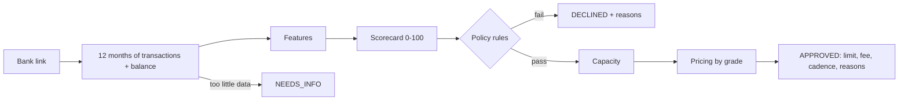

# Cash flow underwriting

CashFlow decides whether to front a business's rent by reading its bank account, not its
credit score. The engine lives in `src/underwriting/` and is pure TypeScript: given a year
of transactions and a current balance it produces a score, a grade, a limit, a fee, and a
list of reasons an applicant can read. No network, no model weights, no hidden state.

This document explains the model so it can be reviewed, argued with, and changed.

## Why cash flow and not credit

Small businesses are thin files. Many have no business credit history, the owner's
personal score says little about the shop's ability to pay rent, and collateral is rarely
available. What every operating business does have is a bank account that shows exactly
how much comes in, how much goes out, when, and how close to the edge it runs. Rent is a
monthly obligation, so the question underwriting must answer is narrow: after everything
else this business pays, is there reliably enough cash on the right days to repay a month's
rent plus a small fee?

## Pipeline

1. **Bank data.** `services/underwriting.ts` asks the `BankLinkProvider` for 365 days of
   transactions and the current balance. Categories are normalized to the
   `TransactionCategory` enum in `packages/shared` so the engine does not care which bank
   data vendor produced them.
2. **Features** (`features.ts`). Transactions are bucketed into full calendar months and
   daily balances are reconstructed backward from the current balance.
3. **Scorecard** (`scorecard.ts`). Eight factors, weights summing to 100, piecewise linear
   curves. Every factor emits a human readable reason tagged positive, negative, or
   informational.
4. **Policy** (`engine.ts`, `POLICY`). Hard rules that decline regardless of score.
5. **Capacity and pricing.** The largest monthly rent the business can carry with a margin
   of safety, and the fee for its grade.

## Features

All money is integer cents and all ratios are basis points, so a stored decision is exact
and reproducible.

| Feature                       | Definition                                                                                                                                                                                   |
| ----------------------------- | -------------------------------------------------------------------------------------------------------------------------------------------------------------------------------------------- |
| Verified monthly revenue      | Mean of operating inflows over the last three full months. Card settlements, cash deposits, invoice payments, and other income, net of refunds. Transfers in and loan proceeds are excluded. |
| Revenue growth                | Last three months versus the prior three. Requires six months.                                                                                                                               |
| Revenue volatility            | Coefficient of variation of monthly revenue.                                                                                                                                                 |
| Deposit days per month        | Distinct days with an operating inflow. A proxy for how continuously the business sells.                                                                                                     |
| Operating outflows and margin | Payroll, rent, suppliers, utilities, insurance, tax, software, fees. Margin is revenue minus operating outflows over revenue.                                                                |
| Net cash flow                 | Revenue minus operating outflows, debt service, and owner draws.                                                                                                                             |
| Debt service                  | Loan and merchant cash advance payments per month, and as a share of revenue.                                                                                                                |
| Observed rent                 | The recurring rent debit already in the account. Once CashFlow pays the landlord this cash is freed up, so it counts toward repayment capacity.                                              |
| Days of cash on hand          | Current balance divided by average daily outflows over 90 days.                                                                                                                              |
| Conduct                       | NSF fees and negative balance days in the last 90 days, plus NSF fees over the year.                                                                                                         |
| Rent to revenue               | Requested rent over verified revenue. The payment to income ratio of this product.                                                                                                           |
| Coverage                      | Free cash (net cash flow plus observed rent) over rent plus fee, times 100.                                                                                                                  |
| Stated variance               | How far the applicant's stated revenue sits above what the bank shows.                                                                                                                       |

## Scorecard

| Factor             | Weight | Full marks                               | Zero                                   |
| ------------------ | ------ | ---------------------------------------- | -------------------------------------- |
| Rent affordability | 20     | Rent at or under 10% of verified revenue | 35% or more                            |
| Cash flow coverage | 20     | Free cash covers rent plus fee 2.0x      | Under 1.0x                             |
| Cash buffer        | 15     | 60 or more days of outflows on hand      | Under 7 days                           |
| Account conduct    | 15     | No NSF fees or negative days in 90 days  | 6 points per NSF, 1.5 per negative day |
| Revenue stability  | 10     | Month to month variation at or under 15% | 60% or more                            |
| Revenue trend      | 10     | Up 10% or more quarter over quarter      | Down 30% or more                       |
| Existing debt      | 5      | Debt service at or under 3% of revenue   | 20% or more                            |
| Bank history       | 5      | 12 months reviewed                       | 3 months or fewer                      |

Grades: A at 80 or above, B at 68, C at 55, D at 45, F below 45.

## Policy rules

Applied after scoring. Any one of these declines the application, and the scorecard
reasons are still returned so the applicant sees the full picture.

- Fewer than 6 months in business (self reported).
- Verified revenue under $5,000 a month.
- More than 2 NSF fees in the last 90 days.
- More than 10 negative balance days in the last 90 days.
- Requested rent above 40% of verified revenue.
- Revenue down more than 25% quarter over quarter.
- No positive free cash flow after expenses, owner draws, and existing debt.
- Score below 45.

Missing information is never a decline. These return NEEDS_INFO with a specific ask:

- No bank account connected.
- Fewer than 6 full months of transactions in the connected account.
- Stated revenue more than 50% above verified revenue. The applicant is asked to connect
  other accounts that receive revenue or correct the figure.

## Capacity and pricing

The approved limit is the largest monthly rent that satisfies both of these, rounded down
to $100:

- **Revenue share.** Rent may be at most a share of verified revenue that depends on grade:
  A 30%, B 25%, C 20%, D 15%.
- **Coverage.** Free cash must cover rent plus fee at least 1.25 times.

If capacity is at least half of the requested rent the application is approved at the lower
limit with a `LIMIT_BELOW_REQUEST` reason, which is a counter offer rather than a decline.
Below half it is declined for `INSUFFICIENT_CAPACITY`.

Fees by grade: A 1.5%, B 2.0%, C 2.5%, D 3.0% of rent per period.

The engine also suggests an installment cadence. Businesses with daily card deposits and a
thin cash buffer, or highly variable revenue, are steered to four smaller installments a
month; everyone else gets the default two.

## Explainability

Every decision stores the full `CashFlowSummary` and a reason list with stable codes
(`RENT_TO_REVENUE`, `EXCESSIVE_OVERDRAFTS`, `LIMIT_BELOW_REQUEST`, and so on) and plain
language messages. The codes are in the spirit of adverse action reason codes: a lender in
the United States must tell a declined applicant the principal reasons, and a model that
cannot name them is not usable in production regardless of its accuracy.

## Testing with the mock bank

The mock `BankLinkProvider` generates a deterministic year of transactions from the public
token. Keywords select a scenario, and `rev_<dollars>` and `rent_<dollars>` pin revenue and
observed rent so the data matches what the applicant stated.

| Token keyword       | What it simulates                                        | Typical outcome                                 |
| ------------------- | -------------------------------------------------------- | ----------------------------------------------- |
| `healthy` (default) | Steady business, modest growth, healthy buffer           | Approved, grade A or B                          |
| `growing`           | Revenue up about 45% over the year                       | Approved                                        |
| `seasonal`          | Strong summer peak                                       | Approved, lower stability score                 |
| `thin_margin`       | Spending close to revenue, small buffer                  | Lower grade or declined on coverage             |
| `heavy_debt`        | SBA loan plus a daily merchant cash advance              | Lower grade, smaller limit                      |
| `volatile`          | Large month to month swings                              | Lower stability score                           |
| `low_balance`       | Healthy flows but almost no cash on hand                 | Lower buffer score, four installments suggested |
| `overdrafts`        | Thin margins, unexpected repair bills, repeated NSF fees | Declined on conduct                             |
| `declining`         | Revenue steps down about half in the last five months    | Declined on trend                               |
| `new_business`      | Only four months of history                              | Needs info                                      |
| `no_balance`        | No data returned                                         | Needs info                                      |

Example: `mock_healthy_rev_48000_rent_6200` is a $48,000 a month business paying $6,200
in rent.

## Swapping in real data

A production deployment replaces the mock bank with a real aggregator. Plaid's
`transactionsSync` with `personal_finance_category`, for example, maps cleanly onto
`TransactionCategory`. The engine does not change. If a vendor cash flow score or a bureau
pull is added later, it implements `UnderwritingProvider` and can blend its signal with the
engine's score; the reason list and stored features keep the decision explainable either way.

## What this is not

This is a reference implementation written to be read. It has not been calibrated against
real repayment outcomes, the weights are judgment rather than fitted coefficients, and it
has no notion of industry seasonality beyond what shows up in the account. Those are the
first three things a real credit team would change.
